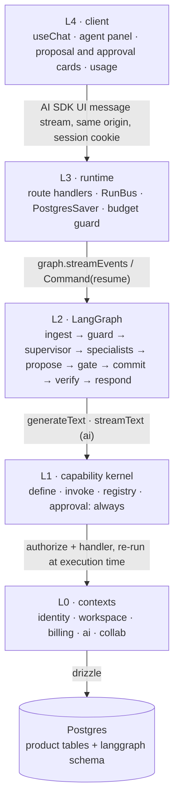
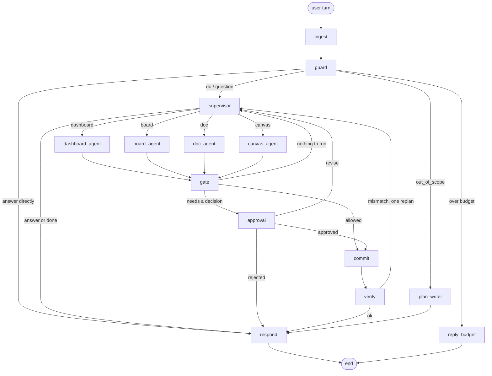

# Agentic layer on LangGraph — architecture & spec

**Status:** proposed · **Date:** 2026-11-26 · **Scope:** every agent surface — the dashboard conversion agent, boards, docs and canvas

The agent performs every operation a member can perform — on a board, its doc, its canvas, and the dashboard account itself — through the same code path the UI uses, with the same permissions, and never with a side effect the model can trigger by itself.

This document is the design of record for that layer: what the codebase actually contains today, how the existing AI SDK runtime moves onto LangGraph without losing a feature, the five layers and their contracts, the persistence and transport shapes, the metering model, and the phase plan with acceptance criteria.

## 1. Decisions locked

| Question              | Decision                                                                                                                                                                                                                                                   |
| --------------------- | ---------------------------------------------------------------------------------------------------------------------------------------------------------------------------------------------------------------------------------------------------------- |
| Migration scope       | **Everything agent-related moves to LangGraph**, including the dashboard conversion agent. One runtime, one graph family, one checkpoint store — not a second agent system beside the old one                                                              |
| The AI SDK            | Stays, at two edges: **the client** (`useChat`, UI message parts, `@ai-sdk/react`) and **the model call** (`generateText` / `streamText` from `ai` inside graph nodes). LangGraph owns state, orchestration and durability; it does not own the provider   |
| Where the graph runs  | In-process Next.js route handlers (`runtime = "nodejs"`) with the Postgres checkpointer; built by a factory behind a `RunDeps` seam so a worker container can host the identical graph later                                                               |
| Thread scope          | **Per person, per account** — `(userId, organizationId)`. A teammate never reads another member's thread; sharing a thread is deferred, not designed in                                                                                                    |
| Approvals             | A capability declared `approval: "always"` suspends the graph with `interrupt()`; the decision resumes it with `Command({ resume })`. The signed-secret replay protection is retired because the checkpoint — not the browser — holds the pending decision |
| Who may approve       | Any member who could have made the same change themselves — checked against the approver's own rights at resume time, not the proposer's                                                                                                                   |
| Tracing               | Product ledger tables only. No LangSmith, no Langfuse in v1                                                                                                                                                                                                |
| Share links           | Agent threads are account-member-only. A share token never exposes thread history, proposals or run logs                                                                                                                                                   |
| Out-of-scope requests | Answer in chat with a step-by-step plan and a "save this to the doc" suggestion; saving it is a normal doc write proposal                                                                                                                                  |

**What "everything" excludes, and why.** Three things in `lib/ai` call a model but are not agents: conversation titles (`lib/ai/titles`, a single `generateObject` with no tools and no thread), read-aloud speech, and voice input. They are one-shot adapters over a provider; wrapping them in a graph would add checkpoints nobody resumes and state nobody reads. They stay on the AI SDK. If that line ever moves — a title that reads the thread and decides — it moves into the graph like everything else.

## 2. Goals and non-goals

**Goals**

- One operation layer that both the UI and the agent call, so the agent's powers and a member's powers cannot drift apart.
- One agent runtime. The dashboard conversion agent and the board/doc/canvas specialists are nodes in the same graph family, sharing the capability kernel, the allowance, the approval gate and the transport.
- Durable threads that survive a process restart: the model sees a state, not a re-posted browser transcript.
- Model output is data, never a call: the model reaches a write only through a capability whose authorization `invoke()` re-runs at execution time, and — where the capability says so — through a person's decision.
- A metered token allowance that replaces the unmeasured "agent prompts per month" unit.
- The client keeps the AI SDK: `useChat`, streamed UI message parts, optimistic tool rendering. Migrating the runtime must not cost the interface its transport.

**Non-goals (v1)**

- Team management through the agent (invite, role change, remove member), billing changes, cross-account workspace creation. The registry shape fits them; they are not built.
- A tracing service. The checkpoint plus the product ledger is the debugger.
- Multi-replica runtime. Single container is assumed and documented; the `RunBus` interface is the seam.
- Shared team threads. Threads are per person; the deferred section of `agent-conversations.md` already lists sharing as future work.
- Stripe metered billing. The subscription decides the plan; our tables decide the allowance.

## 3. Where the codebase actually stands

This part is not a preference — it is what `main` contains today. The earlier draft of this document described a repo that no longer exists, and one table row was simply wrong: workspace CRUD, the capability kernel and the per-context layout all shipped.

| Area              | Today                                                                                                                                                                                                                                                                             | Consequence for this design                                                                                 |
| ----------------- | --------------------------------------------------------------------------------------------------------------------------------------------------------------------------------------------------------------------------------------------------------------------------------- | ----------------------------------------------------------------------------------------------------------- |
| Dependencies      | `ai@^7.0.173`, `@ai-sdk/react@^4.0.177`, `@ai-sdk/openai-compatible@^3.0.92`, `zod@^4`, `pnpm@12.21.0` with a single lockfile                                                                                                                                                     | The LangGraph packages are new; nothing else has to be re-platformed                                        |
| Agent loop        | `ToolLoopAgent` in `lib/ai/runtime/agent/createAgent.ts` — `stopWhen: isStepCount(...)`, `maxRetries`, `instructions`, a per-request `tools` map, plus `toolApproval` + `experimental_toolApprovalSecret` when approval tools are offered                                         | This is the thing being replaced. Its options and defaults are the migration's acceptance criteria          |
| Capability kernel | `lib/capabilities/` — `define`, `invoke`, `registry`, `presentations`, `action`, `changes`, `describe`. Every capability declares `name`, `description`, zod `input`/`output`, `callers: "human" \| "agent"`, optional `approval: "always"`, `authorize`, `handler` and `changes` | Keep it as-is. It is the strongest part of the current design and the reason the migration is cheap         |
| Tools             | `lib/ai/tools/createWorkspaceTools.ts` derives a `ToolSet` by iterating `agentCapabilities`, skipping `approval` tools unless `allowApprovalTools`, and giving client-only capabilities no `execute`                                                                              | Becomes the LangGraph tool adapter; the catalog is unchanged                                                |
| Board operations  | `lib/workspace/capabilities/` — create, update, move, delete, archive, restore, open, get, list                                                                                                                                                                                   | Already the agent's future tool surface. No new L0 needed for boards                                        |
| Doc and canvas    | `doc.content` / `doc.yjsState` and `canvas.content` columns only; no editor, no provider, no sync server                                                                                                                                                                          | The agent cannot edit a doc humans cannot open; doc/canvas tools stay later phases                          |
| Threads           | `agentConversations` / `agentPrompt` / `agentMessage`, per person per account (`organizationId` nullable, `userId` required), single-flight partial unique index, `AWAITING_APPROVAL` status, retry / rewind / branch, `supersededAt` instead of deletes                          | The product rows stay the readable projection; the graph state moves to the checkpointer                    |
| Liveness          | `lib/ai/thread/orphans/retireOrphanedPrompts.ts` plus the process-local `lib/ai/thread/live` registry                                                                                                                                                                             | Replaced by checkpoint resume plus a boot sweep; the in-memory "is anything streaming this?" question stays |
| Transport         | `POST /api/agent/prompts` via `createAgentUIStreamResponse`, `app/api/agent/conversations/*`, `useChat` on the dashboard                                                                                                                                                          | The client contract survives; the server route starts a graph run instead of a `ToolLoopAgent` stream       |
| Metering          | `PlanLimits.agentPromptsPerMonth`, landing copy "20 / 500 / 2000 agent prompts per month", `lib/ai/thread/allowance/promptAllowance.ts`                                                                                                                                           | Becomes a monthly credit allowance with a hard stop (§11)                                                   |
| Titles            | `lib/ai/titles` — `generateObject` against its own `TITLE_AI_*` config                                                                                                                                                                                                            | Out of scope, deliberately (§1)                                                                             |

Two consequences, stated plainly:

1. **The migration is a runtime swap, not a rewrite.** The capability kernel, the registry, the actor, the allowance concept and the product tables' readability are kept. The loop, the approval mechanism, the stream protocol and history replay are replaced by LangGraph equivalents.
2. **One agent does not get to stay behind.** The dashboard conversion agent — the one that turns "plan the schema for invoicing and create a board for it" into `createWorkspace` and a navigation — currently runs the same `ToolLoopAgent`. Leaving it there would mean two runtimes, two approval paths and two metering paths for the same product, which is exactly the drift this layer exists to prevent.

### 3.1 The migration, module by module

| Today                                                               | Migrated to                                                                                                               | What must not change                                                                                  |
| ------------------------------------------------------------------- | ------------------------------------------------------------------------------------------------------------------------- | ----------------------------------------------------------------------------------------------------- |
| `createAgent()` → `ToolLoopAgent`                                   | `StateGraph(AgentState)` compiled with `PostgresSaver`; the agent loop becomes `ingest → guard → supervisor → specialist` | instructions builder, model resolution, `maxSteps`, `maxRetries`                                      |
| `toolApproval: "user-approval"` + `experimental_toolApprovalSecret` | A gate node: `interrupt({ proposalId, tool, args, diff })`, resumed by `Command({ resume: approve \| deny })`             | the decision is still the person's, and `invoke()` still re-authorizes the write                      |
| `agentPrompt.status = AWAITING_APPROVAL`                            | `agentProposal.status = 'pending'` + a checkpoint holding the suspended node                                              | nothing may appear pending twice; the UI still shows one card                                         |
| `retireOrphanedPrompts` + `live` registry                           | Boot sweep marks `running` runs `interrupted`; the next turn resumes from the last checkpoint                             | a restarted server never wedges a thread, and a slow model is never mistaken for a dead one           |
| `createAgentUIStreamResponse`                                       | `graph.streamEvents()` → `createUIMessageStream` → `createUIMessageStreamResponse`                                        | `useChat` and every message part the dashboard renders                                                |
| `agentPrompt` as both execution unit and billing unit               | `agentRun` (execution) + `agentUsage` (billing) + `agentUsagePeriod` (fast counter)                                       | a retry is still free, an approval answer is still a continuation, a branch replay is still uncounted |
| Tool `execute` calling `capability.invoke`                          | LangChain `tool()` whose `execute` calls the same `capability.invoke`; gated ones are intercepted before execution        | the registry remains the only catalog                                                                 |
| `useChat` posting the whole thread                                  | `useChat` posting `{ message }`; the model reads its state from the checkpoint                                            | the browser never becomes the model's memory                                                          |

**The technical hinge.** LangGraph JS nodes are plain async functions over a typed state, so a node calls `generateText` / `streamText` from `ai` directly. No `@langchain/openai`, no chat-model adapter, no second provider configuration: `resolveAiConfig()`, `getLanguageModel()`, `AI_BASE_URL`, the scripted e2e provider and the `test:ai` live check all keep working untouched. `@langchain/core` comes along only for `MessagesAnnotation` and message types, and `@langchain/langgraph-checkpoint-postgres` for the saver.

**The second hinge.** The AI SDK stream protocol is what the dashboard already renders, so the graph does not invent a wire format. Node starts, model deltas and tool calls are translated into UI message chunks; `interrupt` becomes a data part the existing approval card renders; a resumed run continues the same message id. The migration is invisible to a person using the app.

### 3.2 What this buys, concretely

- **Durability stops depending on the browser.** Today an approval answer re-posts the whole conversation and the server trusts the body, which `capabilities.md` already documents as a limit: "the signature is checked against the secret, not against the conversation". With a checkpoint, the decision resumes a specific `thread_id` and the pending state is server-side.
- **A restart costs a step, not a reply.** The orphan sweep exists because a killed process leaves a `RUNNING` row and no way to continue. A checkpoint at the last completed node makes continuation the default.
- **Supervision becomes expressible.** The conversion agent currently answers one goal with one loop. The spec's board/doc/canvas split needs a graph that decides _which_ specialist handles a turn — that is a routing problem, and a `StateGraph` states it in edges instead of in prompts.
- **Metering gets a real unit.** A graph run knows its node count, its subagent choices and its token totals per call; the credit ledger in §11 has something to charge.

### 3.3 What it costs

Stated honestly, because the decision was made with this on the table:

- Two new runtime dependencies and a second state store in the same Postgres (its own `langgraph` schema).
- A new mental model for anyone reading `lib/ai`: nodes, edges, channels and reducers, instead of one `stopWhen` loop.
- The approval mechanism has to be rebuilt around `interrupt`, and the current signed-secret path is deleted rather than adapted.
- The dashboard thread's retry/rewind/branch rules become a mapping over checkpoints — copy-on-branch means writing a checkpoint under a new `thread_id`, not sharing rows.
- Temporary dual support is not allowed: the conversion agent moves in the same change as the loop, or the migration is not done.

## 4. Architecture



The rule that makes the whole thing safe is unchanged, only its mechanism is: **model output is data, never a call.** The model emits a tool call; the capability's `authorize` loads and checks the row; `invoke` validates, authorizes and runs. A capability marked `approval: "always"` cannot run until a person resumes the graph, and when it does run it re-authorizes with that person's actor.

### 4.1 The actor

The repo already has one: `AccountActor` in `lib/identity/actor`, resolved from the Better Auth session and the active account, and `CapabilityContext` carries it as `actor` with `actorType: "agent" | "human"`.

- Built server-side only. `invoke()` never reads a user, account or role from a tool argument; capability inputs are zod schemas that cannot contain one.
- The graph state carries an `ActorSnapshot` (ids + role + plan) for display and routing. **On every resume the actor is rebuilt from the resuming session** — that is what makes "any member who could have made the change" correct rather than a cache of the proposer's rights.
- Client-only capabilities (`openWorkspace`) stay the browser's job: no handler exists, so no server path can pretend the interface did something.

### 4.2 Capabilities

The kernel is the permission model, not a second one beside it:

```ts
// lib/capabilities/define/types.ts (existing)
type Capability<I, T, R> = {
  name: string;
  description: string;
  input: z.ZodType<I>;
  output: z.ZodType<CapabilityOutput<T>>;
  callers: readonly ("human" | "agent")[];
  approval?: "always";          // an agent call suspends until a person decides
  client?: ClientToolHandler;   // the browser performs it
  changes?: (output) => Change[];
  authorize?: (ctx, input) => Promise<R | null> | R | null;
  handler: (ctx, input, resource, options) => CapabilityOutput<T> | Promise<...>;
};
```

What the migration adds:

- `invoke()` stays the single entry, and stays the re-authorization point on resume.
- The registry gains one derived fact: `requiresApproval` is exactly `approval === "always"` (there is no separate risk enum to keep in sync).
- The graph reads the registry for its tool list, its approval set and its generated capability section in the instructions — the same three consumers `capabilities.md` already lists.

| Capability group                                                          | State                                                         |
| ------------------------------------------------------------------------- | ------------------------------------------------------------- |
| `workspace.*` — create, list, get, update, restore, open, archive, delete | shipped; archive and delete are `approval: "always"`          |
| `conversation.*` — branch                                                 | shipped, `callers: ["human"]`                                 |
| `doc.*`, `canvas.*`                                                       | not built; the registry shape already fits them               |
| `team.*`, `billing.*`                                                     | shipped as human capabilities; not exposed to the agent in v1 |

## 5. L0 — the contexts

There is no `lib/domain/` and there should not be: the repo's rule is one folder per bounded context under `lib/<context>/`, with layers as folders, enforced by lint zones and `lib/architecture.test.ts`. The migration keeps that and adds no new top-level folder.

| Context             | What the agent may eventually call                                       |
| ------------------- | ------------------------------------------------------------------------ |
| `lib/identity`      | `AccountActor`, session → active account; no agent-callable mutations    |
| `lib/workspace`     | `capabilities/*` (shipped), doc and canvas read/write (later phases)     |
| `lib/billing`       | entitlements and usage reads; no plan changes through the agent          |
| `lib/ai`            | the graph, the registry adapter, the thread and run store, the allowance |
| `lib/organizations` | membership reads; invitations stay human-only                            |
| `lib/collab`        | the Yjs/Hocuspocus contracts the doc agent will use                      |

Rules that already hold and must keep holding:

- A capability handler is a plain server function, never a `"use server"` endpoint; only `action()` wrappers authenticate and revalidate.
- One behaviour, one module, named for it; no `thing.ts` shim to preserve an old import path.
- Contexts use each other's published functions, never another context's `actions.ts`, schema or SQL.
- No `next/headers`, `next/cache` or `next/navigation` inside a capability — that remains the property that lets an agent call it at all.

## 6. L1 — the registry and the graph's tools

Every power the agent has is one entry in one registry. There is no other way to give it a power, which makes the catalog auditable by reading it.

```ts
// lib/ai/agent/tools/toLangGraphTools.ts — the adapter the migration adds
for (const capability of agentCapabilities) {
  tools[capability.name] = tool({
    description: capability.description,
    schema: capability.inputSchema,
    // A gated capability never executes here: the graph's gate node interrupts
    // first, and the resumed step calls invoke() with the approver's actor.
    invoke: async (input, config) =>
      capability.approval === "always" && !config.gated
        ? gate(capability, input) // throws the interrupt
        : capability.invoke(ctx, input),
  });
}
```

What this keeps from today's adapter:

- `approval` tools are not offered at all when the approval path is unavailable. Today that means "no `AI_TOOL_APPROVAL_SECRET`"; after the migration it means "no checkpointer configured". The degradation stays the same shape: the agent cannot archive, rather than can be told to.
- Client tools have no server execute, so the loop ends when the model calls one and the browser navigates.
- The abort signal is forwarded; Stop cancels the write, not just the stream.

What changes: the two-handler `preview()` / `commit()` split in the earlier draft of this document is **not** the design. `main` already chose `approval: "always"` with the model holding a real, authorized call, and the signed answer travelling through the browser. The migration keeps that model and moves the pause into the graph, where the pending decision is durable. A proposal row still records the operation, its `diff` and its `baseVersion`, so the approval card and the audit trail do not depend on the mechanism.

## 7. L2 — the graph

### 7.1 State

```ts
export const AgentState = Annotation.Root({
  messages: MessagesAnnotation.spec.messages, // reducer: append
  thread: Annotation<{ threadId: string; accountId: string | null }>,
  actor: Annotation<ActorSnapshot>, // display only, never authority
  request: Annotation<{ text: string; kind: RequestKind }, { reducer: last }>,
  budget: Annotation<Budget>, // { limitTokens, usedTokens, exhausted }
  plan: Annotation<PlanStep[]>, // supervisor's remaining steps
  proposalId: Annotation<string | null>,
  decision: Annotation<Decision | null>, // { kind, approverUserId, note }
  commits: Annotation<OpResult[], OpResult[]>, // reducer: concat
  verification: Annotation<Verification | null>,
  deferral: Annotation<Deferral | null>,
  hops: Annotation<number>, // supervisor loop guard
  failure: Annotation<{ code: string; message: string } | null>,
});
```

`RequestKind` is `"do" | "question" | "out_of_scope"`. The state is the checkpoint's payload, which is why nothing critical may live only in the browser.

### 7.2 Top-level graph



| Node              | Uses a model  | Writes                  | Responsibility                                                                                                                                                        |
| ----------------- | ------------- | ----------------------- | --------------------------------------------------------------------------------------------------------------------------------------------------------------------- |
| `ingest`          | no            | no                      | Normalize the turn, resolve the account and target, rebuild the actor, snapshot the plan/entitlements. State comes from the checkpoint, not from a posted transcript. |
| `guard`           | yes (cheap)   | no                      | Classify (`do` / `question` / `out_of_scope`), check the hard budget stop, check the actor can see the target. Runs every turn, so it gets the cheap model.           |
| `plan_writer`     | yes           | no                      | Manual step-by-step plan for out-of-scope requests, plus `suggestedTarget` for the "save this" affordance.                                                            |
| `supervisor`      | yes           | no                      | Choose the specialist, answer directly, or finish. Holds the hop counter (max 4) and the plan.                                                                        |
| `dashboard_agent` | yes           | no                      | The conversion agent: the dashboard's own specialist. Creates, renames, reads and opens workspaces from a prompt; same registry, same gate.                           |
| `board_agent`     | yes           | no                      | Board reads and proposed board operations.                                                                                                                            |
| `doc_agent`       | yes           | no                      | Reads the doc as blocks; proposes doc operations. Later phase.                                                                                                        |
| `canvas_agent`    | yes           | no                      | Reads nodes/edges; proposes canvas operations. Later phase.                                                                                                           |
| `gate`            | no            | **yes** (proposal rows) | Validate ops against capabilities, dedupe, order, compute the diff, persist the proposal, and decide whether any op is `approval: "always"`.                          |
| `approval`        | no            | no                      | `interrupt()` as its first statement; on resume, rebuilds the actor from the approver's session and re-checks every op.                                               |
| `commit`          | no            | **yes** (invoke)        | One capability call per op in `seq` order, recording each result. Marks the proposal `committing` first so a duplicate resume cannot double-apply.                    |
| `verify`          | no            | no                      | Re-read the target and compare with intent. Mismatch → one replan; still mismatched → report partial success.                                                         |
| `respond`         | yes (streams) | yes (projection)        | What changed, who proposed it, who approved it, what failed, links. Writes the message projection for listing.                                                        |
| `reply_budget`    | no            | yes (usage)             | Hard stop with the figures and the upgrade path.                                                                                                                      |

Every specialist has the same internal shape, so there is one pattern to learn and one to test:

```
scope  →  reason  →  decide  →  simulate  →  emit
```

- `scope`: resolve the concrete target and read only the context the model needs.
- `reason`: the loop with read tools bound; every read is logged as a `tool.read` event.
- `decide`: emit the ops, or answer, or hand back to the supervisor with a reason.
- `simulate`: capability, existence, plan limits and the conflict check against the base version; drop ops that cannot commit and say why.
- `emit`: return `{ ops, summary }` up to the parent graph.

The conversion agent is a specialist rather than a separate service for one reason: it already shares every dependency — the registry, the actor, the allowance, the approval gate, the thread — and the only thing that made it look separate was that it was wired directly into the dashboard route.

### 7.3 Edges and the two interrupts

```ts
graph.addEdge("__start__", "ingest");
graph.addEdge("ingest", "guard");
graph.addConditionalEdges("guard", routeGuard, {
  budget: "reply_budget",
  defer: "plan_writer",
  work: "supervisor",
  answer: "respond",
});
graph.addConditionalEdges("supervisor", routeSupervisor, {
  dashboard: "dashboard_agent",
  board: "board_agent",
  doc: "doc_agent",
  canvas: "canvas_agent",
  answer: "respond",
  done: "respond",
});
for (const a of ["dashboard_agent", "board_agent", "doc_agent", "canvas_agent"]) {
  graph.addEdge(a, "gate");
}
graph.addConditionalEdges("gate", routeProposal, {
  supervisor: "supervisor",
  approval: "approval",
  commit: "commit",
});
graph.addConditionalEdges("approval", routeApproval, {
  commit: "commit",
  revise: "supervisor",
  respond: "respond",
});
graph.addEdge("commit", "verify");
graph.addConditionalEdges("verify", (s) => (s.verification?.ok ? "respond" : "supervisor"), {
  respond: "respond",
  supervisor: "supervisor",
});
graph.addEdge("respond", "__end__");
graph.addEdge("reply_budget", "__end__");
graph.addEdge("plan_writer", "respond");
```

`gate` is the single exit of all four specialists, so approval logic exists once: no specialist can reach `commit` directly.

Resume mechanics — this is the replacement for the signed approval answer:

```ts
// approval node, first statement. A resumed node re-executes from its top,
// so everything before this is idempotent; the proposal is already persisted.
const decision = interrupt<ApprovalRequest, ApprovalDecision>({
  proposalId,
  summary,
  ops: ops.map((o) => ({ seq: o.seq, tool: o.tool, diff: o.diff })),
  base: proposal.baseVersion,
});

// the route that handles the card
await graph.invoke(new Command({ resume: { kind: "approve", approverUserId } }), {
  configurable: { thread_id: threadId },
});
```

The approval route rebuilds `ActorContext` from the approver's session and re-runs `requiresApproval` + the capability's own `authorize` for every op. If the approver is not entitled to one of them, the run does not commit and responds naming the op. The batch is the unit of consent — no partial application.

Two threads of pending work are deliberately distinct: a **parked approval** (a person must decide) and an **interrupted run** (the process died). Both are checkpoints; only the first has an `agentProposal` with status `pending`.

### 7.4 Revision loop

`revise` sends the approver's note back to the supervisor as a user-visible message ("Approver asked: keep the old description") and clears the proposal. The supervisor re-plans, capped at 2 revisions per proposal; the third attempt responds with the disagreement instead of looping.

## 8. Commit mechanics, per target

**Workspaces (shipped path).** The capability's handler already validates, applies the plan's quota under an advisory lock and writes. The migration adds one thing at the graph level: the `baseVersion` recorded on the proposal is compared before the write, and a mismatch becomes `CONFLICT`, which `verify` turns into "someone changed this while you were deciding" plus one replan against the new state.

For a create, there is no base version, so idempotency comes from the proposal's `opKey` (a unique index over `threadId + seq + tool + hash(input)`): a retried run cannot create two boards.

**Doc (later phase).** The server keeps a headless `Y.Doc` per open board and commits the proposal as one Yjs transaction with a distinguishable origin:

```ts
const doc = await loadYDoc(boardId); // doc.yjsState
const snapshot = Y.encodeStateVector(doc);
doc.transact(() => {
  for (const op of ordered) applyDocOp(doc, op); // anchors are relative positions
}, `agent:${runId}:${proposalId}`);
await persistYDoc(boardId, Y.encodeStateAsUpdate(doc, snapshot));
await hocuspocus.broadcastUpdate(boardId, update); // connected humans merge it
```

Because the transaction has its own origin, a client-side `Y.UndoManager` that tracks only local origins lets a human undo one agent action with Ctrl+Z without touching their own edits. Anchors are why approval-then-commit is safe: ops carry a block id or relative position, not an index. If a human deleted the anchor in the meantime, that op fails with `ANCHOR_MISSING`, the rest still apply if their anchors resolve, and `verify` hands the failure list back for one replan.

**Canvas (later phase).** `canvas.content` is jsonb with no CRDT, so commit is a read-modify-write in one transaction guarded by `updatedAt`. Node ids are client-generated and preserved, so an add is idempotent by id. A field-level merge is impossible by design; the CAS turns a race into a visible conflict instead of a lost edit.

## 9. Persistence

Two schemas, two owners.

**Checkpointer.** `@langchain/langgraph-checkpoint-postgres` — `PostgresSaver.fromConnString(process.env.DATABASE_URL)` with an explicit `langgraph` schema, so it never collides with the product tables. `saver.setup()` is idempotent and runs from `scripts/agent-setup.ts` (`pnpm agent:setup`, also guarded at boot behind a `globalThis` flag), **not** from drizzle-kit: migrations drizzle did not generate tend to be dropped on the next `db:generate`. Its tables are the source of truth for graph state — messages, plans, pending interrupts.

**Product tables.** Drizzle, in `lib/db/schema/agent*.ts`, following the existing conventions (`@paralleldrive/cuid2` defaults, `timestamp(..., { precision: 3, mode: "date" })`). The existing `agentConversation`, `agentPrompt` and `agentMessage` rows stay readable; the migration adds the execution and audit rows beside them:

```ts
agentRun       id, threadId (fk), conversationId (fk, nullable), status:
               'queued'|'running'|'interrupted'|'committed'|'failed'|'cancelled',
               trigger: 'user'|'approval'|'retry', startedBy, checkpointId,
               model, tokensIn, tokensOut, credits, error, startedAt, endedAt

agentProposal  id, runId, threadId, status: 'pending'|'approved'|'rejected'|
               'committing'|'committed'|'failed'|'superseded', summary,
               proposedBy, baseVersion text, decidedBy, decidedAt, createdAt

agentOperation id, proposalId, seq, tool, targetType, targetId, args jsonb,
               diff text, status: 'pending'|'committed'|'failed'|'skipped',
               result jsonb, error                    unique (proposalId, seq)

agentApproval  id, proposalId, userId, decision: 'approve'|'reject', note, createdAt

agentUsagePeriod ownerType, ownerId, period 'YYYY-MM', creditsLimit, creditsUsed,
                 unique (ownerType, ownerId, period)      -- the atomic counter

agentUsage     id, periodKey, ownerType, ownerId, runId, threadId, userId, model,
               tokensIn, tokensOut, credits, costUsd numeric, createdAt  -- the ledger
```

`agentPrompt` is **not** dropped by this migration. It is the billing and execution row the allowance, retry, rewind and branch rules are written against, and `agent-conversations.md` documents that contract in detail. The graph adds `agentRun` beside it (a run references the prompt that opened it) and the two stay consistent because a run is opened inside the same transaction that opens the prompt.

Both `agentUsage` (append-only ledger) and `agentUsagePeriod` (fast counter) exist on purpose: the ledger answers "what did this cost and who used it", the counter answers "may this run start" without a sum over the ledger. They are written in one transaction, so they cannot disagree.

### 9.1 Thread visibility

Threads are per person per account, per `conversation-accounts.md`:

- Visibility is `(userId, organizationId)` — one predicate, `conversationOwnerConditions`, used by every read. A teammate never sees another member's thread, even in the same organisation.
- Share-token viewers are not actors and have no session, so every agent route rejects them; there is no thread read path that accepts a token.
- `agentMessage.authorUserId` gives attribution ("Dana asked"), and proposals keep both `proposedBy` and `decidedBy`, the pair that matters in an audit.
- A LangGraph `thread_id` is derived from the conversation id and the owner, never from a client-supplied string alone, so a checkpoint cannot be addressed across accounts.

### 9.2 One run at a time per thread

The database keeps the single-flight slot; the graph does not add a second lock:

```sql
-- the same partial unique index the prompts table already has
create unique index on agent_prompt (conversation_id)
  where status in ('QUEUED', 'RUNNING');
```

A second send from another tab gets `409` naming the busy thread, and the composer disables. Ten minutes is the stale ceiling only for a run nothing is streaming (the `live` registry answer). The run itself is bounded by the budget and `recursionLimit`, so the ceiling is a backstop, not the mechanism.

## 10. Transport

All under `app/api/agent/`, all `export const runtime = "nodejs"` and `dynamic = "force-dynamic"`, all authenticated with `auth.api.getSession({ headers })`, and every mutation also checked with the same-origin helper the billing routes use.

| Method | Path                                                | Purpose                                                                            |
| ------ | --------------------------------------------------- | ---------------------------------------------------------------------------------- |
| `POST` | `/api/agent/prompts`                                | the existing entry point: start a turn (append, retry or rewind), stream the reply |
| `POST` | `/api/agent/conversations/[id]/runs`                | start a run explicitly → `202 { runId }`                                           |
| `GET`  | `/api/agent/conversations/[id]/runs/[runId]/stream` | UI message stream for a run                                                        |
| `GET`  | `/api/agent/conversations/[id]`                     | thread state: messages, pending proposal, last run                                 |
| `POST` | `/api/agent/proposals/[id]/decision`                | `{ decision, note? }` → resumes the interrupt → `202`                              |
| `POST` | `/api/agent/conversations/[id]/cancel`              | cancel the live run                                                                |

The client contract does not change: `useChat` posts UI messages and renders message parts, including the approval part. What changes under it is that the server's reply comes from `graph.streamEvents()` translated into UI message chunks with `createUIMessageStream`, rather than from `createAgentUIStreamResponse` over a `ToolLoopAgent`. When `@langchain/react`'s `useStream` becomes worth adopting, it replaces the client and the endpoints stay.

### 10.1 A run is not tied to its request

The `POST` handler starts the graph, hands the event stream to `RunBus`, and returns `202` without awaiting the run. The stream handler subscribes and forwards frames.

- A client disconnect does not stop the run; a reconnect re-subscribes and first receives a `run.snapshot` built from the checkpoint, then live deltas.
- A **process restart** stops the run mid-flight. On boot, any `agentRun` in `running` is marked `interrupted`; the thread shows "the agent was interrupted — continue" and the next turn resumes from the last checkpoint. A run suspended on `interrupt` is unaffected: its state is fully checkpointed and its proposal is in the product tables.
- Single-container assumption: `RunBus` is an in-process `Map<runId, Set<subscriber>>` behind `publish` / `subscribe` / `snapshot`. A second replica would use `LISTEN/NOTIFY` on the same Postgres and no graph or tool code would change.

### 10.2 Stream frames

One JSON object per `data:` line, `event:` naming the type, `id:` a monotonic sequence for resume, `:ping` every 15 s for proxies that cut idle connections.

| Event                                           | Payload                                                     |
| ----------------------------------------------- | ----------------------------------------------------------- |
| `run.snapshot`                                  | checkpoint summary: status, message count, pending proposal |
| `message.delta`                                 | token delta for the assistant message                       |
| `node.started` / `node.finished`                | node name — drives the "reading boards…" indicator          |
| `tool.read`                                     | tool name + a short result summary, never the raw payload   |
| `proposal.created`                              | proposal id, summary, op diffs                              |
| `run.interrupted`                               | proposal id + approval requirements                         |
| `commit.result`                                 | per-op success/failure                                      |
| `verification`                                  | ok, plus mismatch descriptions                              |
| `run.finished` / `run.failed` / `run.cancelled` | status, credits used, error code                            |

Nothing secret goes over the wire: no stack traces, no SQL, no other users' data.

## 11. Metering: prompts → credits

`agentPromptsPerMonth` is the wrong unit: one prompt can cost a hundred tokens or fifty thousand, and the plan copy promises units the product cannot measure. It becomes a monthly allowance of **credits**, 1 credit = 1,000 tokens (input + output), enforced as a hard stop.

### 11.1 Enforcement

1. `guard` resolves the billing owner (the organisation for an org turn, the user for a personal one) and reads `agentUsagePeriod` for the current month. `creditsUsed >= creditsLimit` → the run never starts; `reply_budget` explains the remaining figure and links to billing.
2. The run's token ceiling is `(creditsLimit - creditsUsed) × 1000`, passed down as a per-call budget: a callback on every model response (`generateText` reports `usage`) adds it, and crossing the ceiling sets `budget.exhausted` and raises a typed `BudgetExceeded`, which the graph routes to `reply_budget` — the person gets the work done so far, not an error page.
3. `recursionLimit` (graph steps) and a per-proposal op cap (25) bound what tokens alone do not.
4. On every exit — finished, failed, interrupted — one transaction writes the `agentUsage` rows, increments `agentUsagePeriod.creditsUsed`, and sets the run's token totals. An interrupted run still pays for what it consumed.
5. The increment is a single atomic `update ... set creditsUsed = creditsUsed + $1` guarded by the unique key, so two concurrent runs cannot both squeeze under a spent limit by much. The overshoot is bounded by one model call per run.
6. Month rollover: the first run of a new period upserts the row with the limit from `getUserEntitlements` / `getOrganizationEntitlements` at that moment. A mid-month upgrade raises the limit and keeps usage; a downgrade lowers it and can block the next run.
7. Stripe stays plan-level. No metered billing, no usage records pushed to Stripe.

### 11.2 Proposed limits

The old prompt counts map to roughly equivalent allowances at today's prices, then round to numbers that read well. A starting point to calibrate once real runs exist, not a law:

| Plan       | Today             | Credits / month      | ≈ tokens | ≈ agent turns   |
| ---------- | ----------------- | -------------------- | -------- | --------------- |
| Free       | 20 prompts        | 60                   | 60k      | 25–35           |
| Pro        | 500 prompts       | 1,500                | 1.5M     | 700–900         |
| Team       | 500 prompts (org) | 1,500 pooled per org | 1.5M     | 700–900, shared |
| Enterprise | 2,000 prompts     | 6,000                | 6M       | 3,000+          |

A turn that reads a board, calls a small router and writes one or two ops runs about 1.5–2.5k tokens. A turn that reads a whole doc runs higher, which is why the doc agent gets `get_doc_outline` and `read_doc_range` instead of `get_doc`.

### 11.3 Code that changes

- `lib/billing/plans.ts`: `PlanLimits.agentPromptsPerMonth` → `agentCreditsPerMonth`; the four `features` strings become credit copy. `app/_data/landing.ts` and the pricing components read the catalog, so they follow — but every hard-coded "agent prompts" mention has to be found by hand.
- `lib/billing/entitlements.ts`: expose `remainingCredits(actor)`; the "quota checks are not wired in yet" comment stops being true.
- `lib/ai/thread/allowance/promptAllowance.ts` → `lib/ai/usage/`: `readPeriod`, `assertBudget`, `charge(usage)`, `remainingCredits`.
- Settings/billing UI: a usage meter (used / limit, period end, upgrade CTA) — small, and it is what makes the hard stop feel fair instead of broken.

## 12. Approvals and authority

The rule — _any member may approve, if they could have made the same change themselves_ — has three consequences that need code.

**1. The approver's context, not the proposer's.** `approval` is a resumption, and a resumption can come from a different session hours later. The node never reads `state.actor` for authority; it rebuilds the actor from the request that resumed it, and `commit` runs `invoke()` with that actor. `state.actor` exists to render "Dana asked".

**2. Approval is a capability check, not a role check.** For each op, the capability's `authorize` must succeed for the approver and the target must be readable by them. The check is the same function the UI uses to decide whether to show the archive button, so "could have made the same change" is computed, not described.

**3. The proposal records both people.** `agentProposal.proposedBy` + `decidedBy`, `agentApproval` rows for the note, and the run's `trigger: 'approval'`. The board activity reads "archived by agent, approved by Sam (proposed by Dana)".

What the migration changes, and why it is an improvement: today the decision travels through the browser and is protected by a signed request id, which `capabilities.md` documents as insufficient in one respect — the signature is checked against the secret, not against the conversation, so an approval issued for one thread and posted to another resumes whichever prompt that thread holds. With `interrupt`, the pending decision lives in the checkpoint under a specific `thread_id`; the resume cannot address another thread's suspension, and `invoke()` still re-authorizes. `AI_TOOL_APPROVAL_SECRET` is deleted, along with the `AWAITING_APPROVAL` status's role as the record of a pending decision.

| Case                                                | Behaviour                                                                                                                                                                       |
| --------------------------------------------------- | ------------------------------------------------------------------------------------------------------------------------------------------------------------------------------- |
| Proposer removed from the team before approval      | The proposal stays visible to remaining members; any member who still has the capability may approve. It commits under the approver's authority; attribution keeps the proposer |
| Approver lacks the capability for one op in a batch | The whole proposal is refused at resume, naming the op. Ops are not partially applied — the batch is the unit of consent                                                        |
| Target changed since the proposal                   | Commit returns `CONFLICT`; `verify` sends the new state back for one replan, and the next proposal supersedes the old one                                                       |
| Proposal older than 7 days                          | `superseded` on read; approval returns `410 PROPOSAL_STALE`; the person is invited to re-ask                                                                                    |
| Two members click Approve at once                   | `agentProposal.status` transitions via CAS `pending → committing`; the loser gets `409` and a refreshed state                                                                   |
| Reject with a note                                  | `revise`: the note goes back to the supervisor as a user message, the proposal is cleared, max 2 revisions                                                                      |
| Run cancelled while interrupted                     | The proposal is `rejected` (reason `cancelled`) so it stops appearing as pending                                                                                                |
| Process restarts while parked                       | The checkpoint is intact; the card re-renders from the proposal row and the decision still resumes the same node                                                                |

The interrupt payload is small on purpose: `{ proposalId, summary, ops: [{ seq, tool, diff }], base }`. Diffs are text, not documents, which keeps the checkpoint and the stream frame small and the card renderable without loading the whole doc.

## 13. Out-of-scope requests

When someone asks for something the agent cannot do (billing changes, inviting a teammate in v1, a feature that does not exist), the run does not fail and does not hallucinate a tool. `guard` classifies `out_of_scope`, `plan_writer` produces:

```ts
{ title: "Invite a teammate",
  steps: ["Open Dashboard → Team", "Click Invite member", "Choose Member or Admin", "Send"],
  reason: "Invitations are managed by a team admin; I can't send one.",
  suggestedTarget: "doc" }
```

It streams as a normal assistant message with a numbered list and one affordance: **"Save this plan to the doc"**. That button starts a normal run with `request.kind = 'save_deferral'`, which goes through `doc_agent → gate → commit` like any other write. So the plan is durable only if the person asks for it, there is no second write path, and a deferral cannot bypass approval or a capability check. If the target board has no doc, `suggestedTarget` is `null` and the button creates the doc row as part of the same proposal.

## 14. Evals and observability without a tracing service

Ledger-only means the checkpoint is the debugger. That is enough if the state is legible, so the run row stores `checkpointId`, `model`, `tokensIn/Out`, `credits`, step count and the terminal error code. A support question ("why did it rename the wrong board?") is answered by loading that checkpoint and reading `messages` and the proposal rows — the same data the person saw.

| Layer                                                              | What it proves                                                                                                                             | How                                                                                       |
| ------------------------------------------------------------------ | ------------------------------------------------------------------------------------------------------------------------------------------ | ----------------------------------------------------------------------------------------- |
| Pure unit (`lib/capabilities/*.test.ts`, `lib/ai/agent/*.test.ts`) | the registry invariants, the approval set, proposal validation (batch refusal, stale, duplicate seq), credit math and period rollover      | plain vitest, no DB                                                                       |
| Domain (`lib/workspace/**/*.test.ts`)                              | a capability rejects a member's archive even when called directly; CAS conflict returns `CONFLICT`; the plan's board limit                 | test database (`pnpm db:up`) or a repository fake                                         |
| Graph (`lib/ai/agent/graph/*.test.ts`)                             | routing: budget stop, out-of-scope → plan, approval interrupt → approve → commit, reject → revise, verify mismatch → one replan, loop caps | `StateGraph` compiled with `MemorySaver` and a scripted model — deterministic, no network |
| Live (`lib/ai/live.test.ts`)                                       | the provider contract, unchanged by the migration                                                                                          | `AI_LIVE=1 pnpm test:ai`                                                                  |

The test that matters most is not a graph test: **a proposal for an op the approver cannot perform must not commit, even if the model proposed it and the person clicked approve.** That is a pure unit assertion on the approval policy plus a capability-level assertion, and it must exist before the first gated tool does.

No LangSmith in v1. When it is wanted, the graph gains a callback handler; nothing else changes, because the graph receives its dependencies through `RunDeps`.

## 15. Phasing and acceptance criteria

The migration is phase 0, because every later phase would otherwise be built twice.

| Phase                                     | Scope                                                                                                                                                                                                                                                                                                                                                                            | Size         | Acceptance criteria                                                                                                                                                                                                                                                                  |
| ----------------------------------------- | -------------------------------------------------------------------------------------------------------------------------------------------------------------------------------------------------------------------------------------------------------------------------------------------------------------------------------------------------------------------------------- | ------------ | ------------------------------------------------------------------------------------------------------------------------------------------------------------------------------------------------------------------------------------------------------------------------------------ |
| **0 — Move the runtime to LangGraph**     | `@langchain/langgraph`, `@langchain/core`, `@langchain/langgraph-checkpoint-postgres`; `scripts/agent-setup.ts`; state, graph skeleton (`ingest → guard → supervisor → dashboard_agent → gate → commit → verify → respond`); tool adapter over the registry; UI message stream translation; the dashboard conversion agent moved onto the graph; boot sweep for interrupted runs | L (1–1.5 wk) | The dashboard agent creates, renames, reads and opens a workspace exactly as before; history survives a restart; `ToolLoopAgent` is gone from `lib/`; archive and delete still pause for a decision, now via `interrupt`; `pnpm lint`, `pnpm tsc`, `pnpm test` and `pnpm build` pass |
| **1 — Durable threads and the read path** | `agentRun`/`agentProposal`/`agentOperation`/`agentApproval` tables; conversation ↔ checkpoint mapping; retry, rewind and branch over checkpoints; thread state route                                                                                                                                                                                                             | M (3–5 d)    | Reload and restart both preserve a thread; a branch copies turns without charging; a run that died mid-stream resumes instead of being retired                                                                                                                                       |
| **2 — Board specialist**                  | `board_agent` over `lib/workspace/capabilities`; board reads and proposed writes; diffs and base versions; `verify` replan                                                                                                                                                                                                                                                       | M (1 wk)     | "Rename the onboarding board to Activation" shows a diff, applies and is confirmed by a re-read; a human edit between proposal and commit is a conflict, not a lost update                                                                                                           |
| **3 — Metering**                          | credits model, `agentUsage*` tables, hard stop, plan copy migration, usage meter                                                                                                                                                                                                                                                                                                 | M (3–5 d)    | A free account stops at its allowance with a clear message and an upgrade path                                                                                                                                                                                                       |
| **4 — Docs**                              | Yjs server (Hocuspocus, same container, own port, session auth), editor UI, `yjsState` persistence, doc tools, shadow-doc diff, replay commit                                                                                                                                                                                                                                    | XL (2–3 wk)  | A human and the agent edit one doc, and Ctrl+Z undoes only the agent's insert                                                                                                                                                                                                        |
| **5 — Canvas**                            | canvas editor, canvas tools, jsonb CAS commit                                                                                                                                                                                                                                                                                                                                    | M (1 wk)     | Same as docs, with conflict surfaced instead of merged                                                                                                                                                                                                                               |

Phase 4 is why the plan is sequenced this way: it is bigger than 0–3 combined and is blocked on the editor existing. Designing doc ops against an imagined document model is the most expensive kind of rework.

### File layout

```
lib/ai/agent/
  graph/                 state.ts, graph.ts, deps.ts
                         nodes/ ingest, guard, gate, approval, commit, verify, respond, reply-budget, plan-writer
                         agents/ supervisor, dashboard, board, doc, canvas, shared/{scope,reason,decide,simulate,emit}
  tools/                 toLangGraphTools.ts (the registry adapter), serverTools.ts
  runtime/               runs.ts, runBus.ts, stream.ts (UI message chunks), checkpointer.ts, yjs.ts (phase 4)
  usage/                 readPeriod, assertBudget, charge, remainingCredits
lib/ai/thread/           existing rules/store/allowance/turn modules, adapted to read run + checkpoint state
lib/capabilities/        unchanged — the registry every tool and action derives from
lib/db/schema/           agentRun, agentProposal, agentOperation, agentApproval, agentUsage*
scripts/agent-setup.ts   PostgresSaver.setup() + boot guard
app/api/agent/           prompts, conversations/…, proposals/…/decision
```

`lib/ai/agent/**` is `import "server-only"` except the shared types the client needs (stream event names, the proposal shape), which live in a `protocol.ts` with no server imports — the same split the repo already uses for form contracts.

## 16. Risks and tuning knobs

| Risk                                                               | Mitigation                                                                                                                                                             |
| ------------------------------------------------------------------ | ---------------------------------------------------------------------------------------------------------------------------------------------------------------------- |
| The migration becomes two runtimes                                 | phase 0 is not done until `ToolLoopAgent` is deleted and the conversion agent runs on the graph; no dual path, no feature flag left behind                             |
| Two sources of truth for messages (checkpoint vs `agentMessage`)   | the projection is written once at `respond`; reads come from the projection, graph memory from the checkpoint, and a mismatch is repaired by re-reading the checkpoint |
| The model proposes a write it cannot perform                       | the capability's `authorize` runs before the op reaches the proposal, and `invoke()` re-authorizes at commit. Two independent gates, one function                      |
| Approval fatigue turns into rubber-stamping                        | only `approval: "always"` capabilities pause (archive, delete); the card leads with the diff, not the prose                                                            |
| Replan loops burn credits                                          | 2 revisions, 4 supervisor hops, 25 ops per proposal, a per-run token ceiling, `recursionLimit`                                                                         |
| SSE behind a buffering proxy                                       | `force-dynamic`, `no-store`, 15 s pings, `X-Accel-Buffering: no`; verified against the deployment's proxy before shipping                                              |
| Next 16 caching a GET                                              | every agent route is `dynamic = "force-dynamic"`; nothing under `lib/ai/agent` uses `use cache`                                                                        |
| Share-token leak into thread history                               | agent routes never read `shareToken`; visibility is `(userId, organizationId)`; a test asserts a token-only request gets 401                                           |
| Multi-replica deployment silently breaks SSE and the live registry | documented single-container assumption; `RunBus` interface and a DB lease are the only changes                                                                         |
| Credit overshoot                                                   | bounded by one model call; stated in the copy; the counter update is atomic                                                                                            |
| LangGraph upgrade churn                                            | the graph is behind `RunDeps`; nodes take plain functions, and the checkpoint package is the only surface the app codes against                                        |

Open knobs, deliberately not decided here: the model and the cheap-router pair; whether creating a share link needs approval (billing-adjacent, one line in the registry if so); thread cap per conversation list (archive rather than delete); proposal expiry (7 days); and the credit numbers in §11.2, which should be re-derived after the first hundred real runs rather than argued about now.

## 17. First three things to do

1. Add the three LangGraph packages and `scripts/agent-setup.ts`, compile a two-node graph (`ingest → respond`) with `PostgresSaver` and prove a run survives a restart on the real database. No UI, no tools.
2. Move the dashboard turn onto that graph behind the existing route, with the registry adapter and the UI message stream — the conversion agent still creates workspaces exactly as today. Delete `ToolLoopAgent` in the same change.
3. Replace the signed approval answer with `interrupt` + `Command`, and port the `AWAITING_APPROVAL` behaviour onto `agentProposal`. The test to write first: an approval posted for another thread cannot commit anything.
