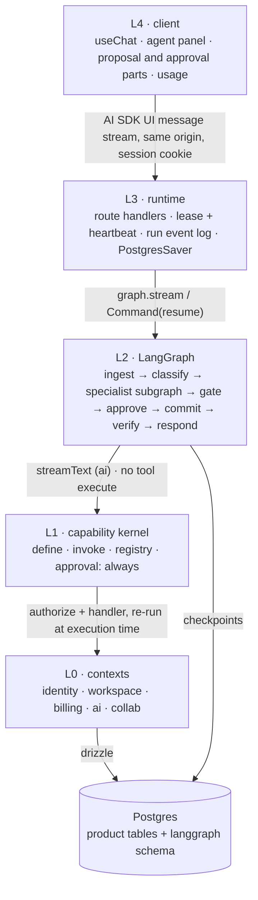
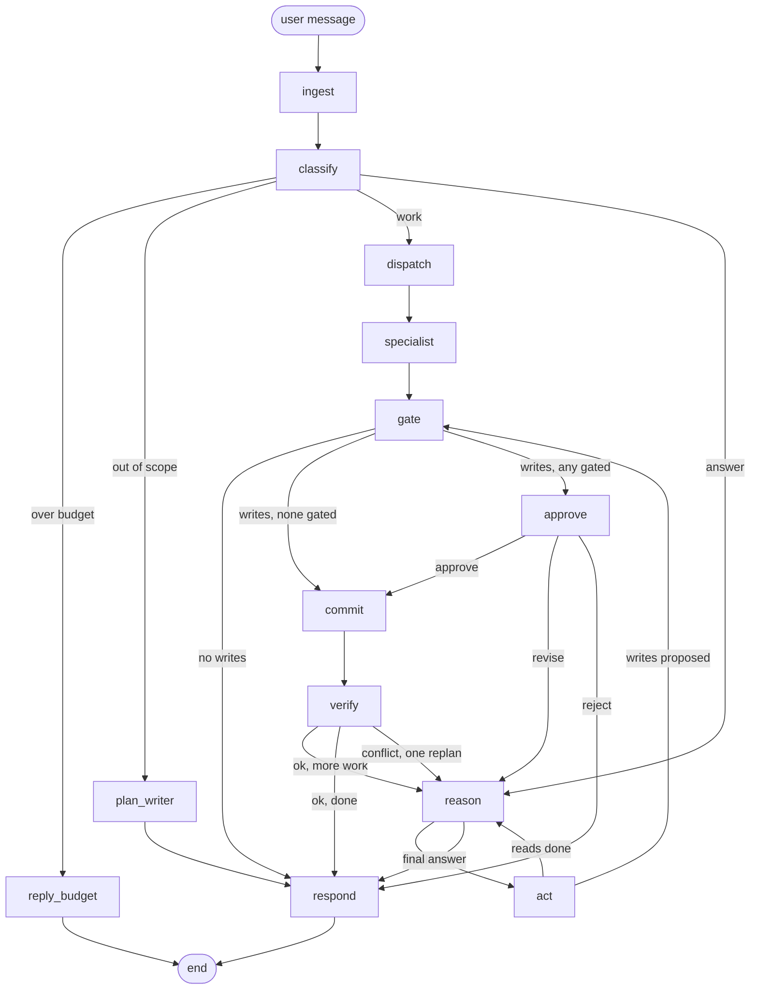

# Agentic layer on LangGraph — architecture & spec

**Status:** proposed · **Date:** 2026-11-26 · **Scope:** every agent surface — the dashboard conversion agent, boards, docs and canvas

The agent performs every operation a member can perform — on a board, its doc, its canvas, and the dashboard account itself — through the same code path the UI uses, with the same permissions, and never with a side effect the model can trigger by itself.

This is the design of record for that layer. It is written as a **target architecture, not a port**: the app is not deployed, so nothing in this document is shaped by the need to keep the current agent runtime, thread store or tables alive. Where the existing code already is the right thing — the capability kernel, the actor, the provider configuration, the composer — it is kept and named as kept. Everything else is replaced, and the replacement is the smallest design that is correct on its own terms.

## 1. Decisions locked

| Question              | Decision                                                                                                                                                                                                                                          |
| --------------------- | ------------------------------------------------------------------------------------------------------------------------------------------------------------------------------------------------------------------------------------------------- |
| Migration scope       | **Everything agent-related moves to LangGraph**, including the dashboard conversion agent. One runtime, one graph family, one checkpoint store — not a second agent system beside the old one                                                     |
| Shape of the change   | **Rewrite, don't adapt.** The legacy loop, thread store and thread tables are deleted in the same change that introduces the graph. A shim that reproduces old behaviour is a defect, not a migration step                                        |
| Schema                | Pre-production, so the agent tables are **replaced by one migration**: no backfill, no `legacy-*` rows, no dual-write window, no compatibility views                                                                                              |
| Owner of conversation | **LangGraph checkpoints own the transcript.** Product tables own identity, money, approvals and audit. There is exactly one copy of a message, and it is the checkpoint's                                                                         |
| The AI SDK            | Stays, at two edges: **the client** (`useChat`, UI message parts, `@ai-sdk/react`) and **the model call** (`streamText` from `ai` inside graph nodes). LangGraph owns state, routing, durability and tool execution; it does not own the provider |
| Tool execution        | **The graph executes tools, never the model call.** Nodes call `streamText` with tool schemas only (no `execute`), then a node runs the calls. Every tool call is a checkpointed superstep: resumable, auditable, budgeted and gateable           |
| Writes                | **Every model-initiated write is a proposal.** Reads execute inline during reasoning; writes are collected, validated, optionally approved, then committed through `invoke()`. No capability write runs inside a model step                       |
| Approvals             | A capability declared `approval: "always"` suspends the graph at one `approve` node with `interrupt(payload, { responseSchema })`; the decision resumes it with `Command({ resume })`. The signed-secret replay path is deleted, not wrapped      |
| Who may approve       | Any member who could have made the same change themselves — the actor is rebuilt from the **resuming** session and every op is re-authorized against it                                                                                           |
| Thread scope          | **Per person, per account** — `(userId, organizationId)`. A teammate never reads another member's thread; sharing a thread is deferred, not designed in                                                                                           |
| Liveness              | A run holds a **database lease** with a heartbeat. No in-process registry of "what is streaming", no timestamp heuristic                                                                                                                          |
| Transport             | The reply is an **AI SDK UI message stream** over SSE, fed by a durable run event log. A disconnect reattaches; a restart resumes from the last checkpoint                                                                                        |
| Metering              | Monthly **credits** (1 credit = 1,000 tokens), **reserved at run start** and settled at exit, with a hard stop                                                                                                                                    |
| Tracing               | Product ledger and run event log only. No LangSmith, no Langfuse in v1                                                                                                                                                                            |
| Share links           | Agent threads are account-member-only. A share token never exposes thread history, proposals or run logs                                                                                                                                          |
| Out-of-scope requests | Answer in chat with a step-by-step plan and a "save this to the doc" suggestion; saving it is a normal doc write proposal                                                                                                                         |

**What "everything" excludes, and why.** Three things in `lib/ai` call a model but are not agents: conversation titles (`lib/ai/titles`, one `generateObject` with no tools and no thread), read-aloud speech, and voice input. They are one-shot adapters over a provider; wrapping them in a graph adds checkpoints nobody resumes and state nobody reads. They stay on the AI SDK. If that line ever moves — a title that reads the thread and decides — it moves into the graph like everything else.

## 2. Goals and non-goals

**Goals**

- One operation layer that both the UI and the agent call, so the agent's powers and a member's powers cannot drift apart.
- One agent runtime: the dashboard conversion agent and the board/doc/canvas specialists are subgraphs of one graph family, sharing the capability kernel, the budget, the approval gate and the transport.
- A durable thread that survives a process restart because the state, not a re-posted browser transcript, is what the model reads.
- Model output is data, never a call: the model asks for a capability, a node validates it, and only `invoke()` — re-authorizing with the acting person's actor — writes.
- An approval mechanism where the pending decision is server-side state, tied to one thread and one proposal.
- A metered allowance that is enforced before the work starts, not measured after.
- The client keeps the AI SDK: `useChat`, streamed UI message parts, optimistic tool rendering.

**Non-goals (v1)**

- Team management through the agent (invite, role change, remove member), billing changes, cross-account workspace creation. The registry shape fits them; they are not built.
- A tracing service. The checkpoint plus the run ledger is the debugger.
- Shared team threads.
- Stripe metered billing. The subscription decides the plan; our tables decide the allowance.
- Multi-region or event-sourced history. One Postgres, one schema pair, many identical app instances.

## 3. Where the codebase stands, and what is deleted

This section is what `main` contains today, and what happens to each part. It is deliberately blunt: the previous revision of this document tried to preserve the old thread machinery underneath a new runtime, which would have left two owners of the same facts and a set of adapters whose only purpose was to keep old behaviour recognisable.

| Area                        | Today                                                                                                                                                                                                                                                      | This design                                                                                                                                                         |
| --------------------------- | ---------------------------------------------------------------------------------------------------------------------------------------------------------------------------------------------------------------------------------------------------------- | ------------------------------------------------------------------------------------------------------------------------------------------------------------------- |
| Agent loop                  | `ToolLoopAgent` in `lib/ai/runtime/agent/createAgent.ts` — `stopWhen: isStepCount(...)`, `maxRetries`, instructions, a per-request tool map, plus `toolApproval` + `experimental_toolApprovalSecret` when approval tools are offered                       | **Deleted.** Replaced by an explicit `reason → act` cycle in the graph (§7)                                                                                         |
| Tool adapter                | `lib/ai/tools/createWorkspaceTools.ts` returns AI SDK `ToolSet` entries whose `execute` closes over the actor and calls `capability.invoke`                                                                                                                | **Deleted.** Replaced by a projection of the registry into read tools and write proposals (§6.2)                                                                    |
| Capability kernel           | `lib/capabilities/` — `define`, `invoke`, `registry`, `presentations`, `action`, `changes`, `describe`. Every capability declares `name`, `description`, zod `input`/`output`, `callers`, optional `approval: "always"`, `authorize`, `handler`, `changes` | **Kept.** The strongest part of the current design; the only addition is an optional expected-version argument (§6.3)                                               |
| Thread store                | `lib/ai/thread/{rules,prompts,turn,conversations,branches,messages,parts,allowance,orphans,live}` — prompt rows, stored messages, retry, rewind, branch, approval parking, orphan retirement, an in-process "streaming" registry                           | **Deleted.** Checkpoints own history; a thread row owns identity and a run row owns execution (§9)                                                                  |
| Agent tables                | `agentConversation`, `agentPrompt` (prompt + execution + billing in one row), `agentMessage` (a second copy of the transcript)                                                                                                                             | **Dropped** in the same migration. Replaced by `agentThread`, `agentRun`, `agentRunEvent`, `agentProposal`, `agentApproval`, `agentOperation`, `agentUsage*` (§9.2) |
| Transport                   | `POST /api/agent/prompts` → `runDashboardTurn` → `createAgentUIStreamResponse`; the whole conversation is posted on every send                                                                                                                             | **Replaced.** `POST /threads/[id]/turns` posts one message; the reply streams from graph events (§10)                                                               |
| Liveness                    | `retireOrphanedPrompts` + `lib/ai/thread/live` (in-process `Map` of streaming prompt ids), documented as correct only on one server                                                                                                                        | **Replaced** by a run lease with heartbeat and a reaper (§9.5)                                                                                                      |
| Metering                    | `PlanLimits.agentPromptsPerMonth`, "20 / 500 / 2000 agent prompts per month" copy, `promptAllowance.ts`                                                                                                                                                    | **Replaced** by reserved credits (§11)                                                                                                                              |
| Titles                      | `lib/ai/titles` — `generateObject` against its own `TITLE_AI_*` config                                                                                                                                                                                     | **Kept, unchanged.** One-shot call, not an agent                                                                                                                    |
| Providers                   | `lib/ai/providers` — `resolveAiConfig`, `getLanguageModel`, `@ai-sdk/openai-compatible`, the scripted e2e server                                                                                                                                           | **Kept, unchanged.** No LangChain model adapter is introduced                                                                                                       |
| Composer, read-aloud, voice | `lib/ai/thread/composer`, `lib/ai/thread/read-aloud` — client-side queue, key handling, dictation, speech                                                                                                                                                  | **Kept.** They speak the UI message stream and do not know what produces it                                                                                         |
| Doc and canvas              | `doc.content` / `doc.yjsState` and `canvas.content` columns only; no editor, no provider, no sync server                                                                                                                                                   | Unchanged conclusion: doc/canvas tools stay later phases, behind a human editor                                                                                     |

### 3.1 Deleted, not adapted

Each row is a thing the previous draft would have kept for compatibility. None of them survives.

| Would have been kept                                      | Why that was wrong                                                                                                                                            | Replacement                                                             |
| --------------------------------------------------------- | ------------------------------------------------------------------------------------------------------------------------------------------------------------- | ----------------------------------------------------------------------- |
| `agentPrompt` as execution **and** billing **and** prompt | Three facts in one row means a retry, an approval answer and a branch all mutate a billing record; the query surface grows a status for every product concern | `agentRun` (execution), `agentUsage` (billing), checkpoint (transcript) |
| `agentMessage` beside the checkpoint                      | Two copies of one conversation, reconciled by a "repair by re-reading the checkpoint" rule — a workaround for a problem this design does not create           | The checkpoint is the transcript; `GET` reads it (§9.3)                 |
| `agentPrompt.status = AWAITING_APPROVAL`                  | A prompt status that means "a person must decide" duplicates the proposal row and the checkpoint's interrupt                                                  | `agentProposal.status = 'pending'` + checkpointed interrupt (§7.6)      |
| `live` in-process streaming registry                      | Correct only on one instance, and it cannot survive a rolling deploy — the exact production case it was excused from                                          | Run lease + heartbeat + reaper (§9.5)                                   |
| `RunBus` (in-process subscriber `Map`)                    | A second source of truth for "what happened", lost on restart, and the reason streams cannot resume                                                           | Durable `agentRunEvent` + Postgres `LISTEN/NOTIFY` (§10.3)              |
| `experimental_toolApprovalSecret` signature               | Signs the _request_, not the conversation; documented as resumable into the wrong thread                                                                      | `interrupt` under a `thread_id` + approver re-authorization (§7.6)      |
| `capability.invoke` inside a tool's `execute`             | The actor is captured when the tool set is built, so a resume hours later would commit with the proposer's stale rights                                       | `commit` node rebuilds the actor from the resuming invocation (§7.7)    |
| Retry/rewind as copied prompt and message rows            | Copies history to represent a branch, then marks copies so they are not billed — bookkeeping that exists only to hide the copy                                | Checkpoint pointers: `agentThread.parentThreadId` + seeded state (§9.3) |
| A `langgraph` schema "beside" the old tables              | Two owners of the same conversation, with no rule for which one a read should trust                                                                           | One owner per fact (§9.1)                                               |

### 3.2 Kept, with the one change each needs

| Kept                                   | Change                                                                                           |
| -------------------------------------- | ------------------------------------------------------------------------------------------------ |
| `lib/capabilities`                     | `CapabilityOptions` gains `expectedVersion`; the registry gains a read/write projection (§6.3)   |
| `lib/identity` `AccountActor`          | None. It is rebuilt per invocation instead of closed over (§5)                                   |
| `lib/ai/providers`                     | None                                                                                             |
| `lib/ai/titles`                        | None                                                                                             |
| `lib/ai/thread/composer`, `read-aloud` | Re-point at the new turn endpoint and message parts; the queue and dictation logic are unchanged |
| `lib/workspace/capabilities`           | None. Board writes already have `authorize` + a versioned row                                    |

## 4. Architecture



One rule makes the whole thing safe, and every layer exists to enforce it: **model output is data, never a call.** The model emits a tool call; a node validates it; a capability's `authorize` loads and checks the row; `invoke` runs it. A capability marked `approval: "always"` cannot run until a person resumes the graph, and when it does run it re-authorizes with that person's actor.

## 5. The actor

The repo already has one: `AccountActor` in `lib/identity/actor`, resolved from the Better Auth session and the active account, and `CapabilityContext` carries it as `actor` with `actorType: "agent" | "human"`.

- Built server-side only. `invoke()` never reads a user, account or role from a tool argument; capability inputs are zod schemas that cannot contain one.
- **Passed as graph runtime context, not state.** `graph.invoke(input, { context: { actor }, configurable: { thread_id } })`. A node reads `config.context.actor`; the state carries only an `ActorSnapshot` (ids, role, plan) for display.
- **Rebuilt for every invocation, including a resume.** That is what makes "any member who could have made the change" correct rather than a cache of the proposer's rights. There is no path that commits with an actor captured when a tool set was built.
- Client-only capabilities (`openWorkspace`) stay the browser's job: no handler exists, so no server path can pretend the interface did something.

## 6. L1 — the capability kernel and its projections

The kernel is the permission model, not a second one beside it:

```ts
// lib/capabilities/define/types.ts (existing, with one addition)
type Capability<I, T, R> = {
  name: string;
  description: string;
  input: z.ZodType<I>;
  output: z.ZodType<CapabilityOutput<T>>;
  callers: readonly ("human" | "agent")[];
  approval?: "always"; // an agent proposal waits for a person
  client?: ClientToolHandler; // the browser performs it
  changes?: (output) => Change[];
  authorize?: (ctx, input) => Promise<R | null> | R | null;
  handler: (ctx, input, resource, options: CapabilityOptions) => CapabilityOutput<T>;
};
```

### 6.1 Reads and writes are a declared property, not a guess

The graph has to know, before the model is asked, which calls it may run inline and which must become proposals. Inferring that from the tool name, or from the absence of `approval`, is the kind of convention that silently breaks when a capability is added.

A capability gains one field:

```ts
effect: "read" | "write";
```

`effects` are enforced by a registry test: every capability has one, every `write` has `authorize`, no `read` has `changes`, and `approval: "always"` implies `write`. That test is the thing that stops a new capability from being accidentally agent-executable.

### 6.2 The registry's two projections

```ts
// lib/ai/agent/tools/projectCapabilities.ts
for (const capability of agentCapabilities) {
  if (capability.effect === "read") readTools[capability.name] = schemaOnly(capability);
  else writeCalls[capability.name] = schemaOnly(capability);
}
```

Both projections produce **schemas only** — AI SDK `tool()` entries with a description and an input schema, and deliberately no `execute`. The model can ask; only a node can act. This is what removes the adapter's two hidden behaviours: no `execute` closure over an actor, and no interrupt thrown from inside a tool.

Client capabilities (`openWorkspace`) are offered the same way and are handled by `act`: the node records the intent, the stream emits a `tool` part, and the browser navigates. The server never claims the navigation happened.

### 6.3 The kernel's one addition: expected version

Optimistic concurrency is a property of a row, not of a tool. A board update should be able to say "only if this is still version 7" without teaching the model about versions.

```ts
type CapabilityOptions = {
  signal?: AbortSignal;
  /** Commit only if the authorized row still has this version. */
  expectedVersion?: string;
};
```

A handler that mutates a versioned row compares it inside the same transaction that writes and returns `CONFLICT` on a mismatch. Capabilities that cannot be compared ignore it. The graph never invents a version: `gate` records the one `authorize` returned.

### 6.4 What the agent may eventually call

| Capability group                                                          | State                                                           |
| ------------------------------------------------------------------------- | --------------------------------------------------------------- |
| `workspace.*` — create, list, get, update, restore, open, archive, delete | shipped; archive and delete are `approval: "always"`            |
| `conversation.*` — branch                                                 | replaced by checkpoint branching, so this becomes human-only UI |
| `doc.*`, `canvas.*`                                                       | not built; the registry shape already fits them                 |
| `team.*`, `billing.*`                                                     | shipped as human capabilities; not exposed to the agent in v1   |

## 7. L2 — the graph

### 7.1 State

State is what the checkpoint holds. It is typed channels with reducers, and the message channel is the AI SDK's own `UIMessage` — the same shape the client renders — so there is one message representation in the system, converted to model messages only at the call edge (`convertToModelMessages`).

```ts
export const AgentState = Annotation.Root({
  // The transcript. Appends new ids, replaces an id that is being streamed.
  messages: Annotation<UIMessage[], UIMessage[]>({ reducer: mergeMessages, default: () => [] }),
  turn: Annotation<Turn, Turn>({ reducer: last }), // threadId, turnId, text, uiContext
  actor: Annotation<ActorSnapshot, ActorSnapshot>({ reducer: last }), // display only
  plan: Annotation<PlanStep[], PlanStep[]>({ reducer: replace }),
  calls: Annotation<ToolCall[], ToolCall[]>({ reducer: replace }), // what reason just asked for
  ops: Annotation<Operation[], Operation[]>({ reducer: mergeByKey }), // proposed writes
  results: Annotation<OpResult[], OpResult[]>({ reducer: mergeByKey }),
  proposalId: Annotation<string | null, string | null>({ reducer: last }),
  decision: Annotation<Decision | null, Decision | null>({ reducer: last }),
  verification: Annotation<Verification | null, Verification | null>({ reducer: last }),
  budget: Annotation<Budget, Budget>({ reducer: mergeBudget }), // limit, used, reserved
  step: Annotation<number, number>({ reducer: (a, b) => b }), // reasoning steps this turn
  replans: Annotation<number, number>({ reducer: (a, b) => b }),
  revision: Annotation<number, number>({ reducer: (a, b) => b }),
  failure: Annotation<Failure | null, Failure | null>({ reducer: last }),
});
```

Three rules about this state:

1. **Nothing critical lives only in the browser.** A reload re-renders from `messages`; a restart resumes from the checkpoint.
2. **No authority lives in state.** `actor` is a display snapshot; `budget` is a copy of a reserved number that the usage tables own.
3. **Every channel has a bounded size.** `ops` and `results` are replaced per proposal; `messages` is trimmed by the compaction rule (§9.6), not left to grow forever.

### 7.2 The turn, as a cycle



The cycle is the ReAct loop stated as edges. That is the single most important design choice in this document, and §7.3 defends it.

| Node           | Model | Side effects               | Responsibility                                                                                                                                                              |
| -------------- | ----- | -------------------------- | --------------------------------------------------------------------------------------------------------------------------------------------------------------------------- |
| `ingest`       | no    | none                       | Append the user message to state, resolve the thread and account, snapshot the actor for display, read the credit period, acquire the run lease. Idempotent by `turnId`.    |
| `classify`     | yes   | none                       | `do` / `question` / `out_of_scope`, plus a target hint (board, doc, canvas, dashboard). Cheap model.                                                                        |
| `plan_writer`  | yes   | none                       | Manual step-by-step plan for out-of-scope requests, plus `suggestedTarget` for "save this".                                                                                 |
| `dispatch`     | no    | none                       | Route to a specialist subgraph by target. Deterministic.                                                                                                                    |
| `specialist`   | yes   | none                       | A compiled subgraph (§7.4) whose internal nodes are `reason` and `act`. It may call reads; it returns proposed writes.                                                      |
| `gate`         | no    | **yes** (proposal rows)    | Validate proposed calls against the registry, authorize each with the acting actor, order them, compute diffs, persist the proposal. Decides whether any op needs approval. |
| `approve`      | no    | none                       | `interrupt()` as its first statement. On resume: rebuild the actor from the resuming session, re-authorize every op, record the decision.                                   |
| `commit`       | no    | **yes** (`invoke`)         | Claim each op by idempotency key, call `invoke()` in order, record the result. Marks the proposal `committing` first so a duplicate resume cannot double-apply.             |
| `verify`       | no    | none                       | Re-read each target and compare with the op's intent. Mismatch → one replan; still mismatched → report partial success.                                                     |
| `reason`       | yes   | none                       | One `streamText` call with read tools and write schemas bound. Streams prose; returns `toolCalls` or a final answer.                                                        |
| `act`          | no    | **reads only**             | Execute read calls in parallel through `invoke()`; append their results as tool parts. Collect write calls as `ops` and hand them to `gate`.                                |
| `respond`      | yes   | **yes** (run projection)   | What changed, who proposed it, who approved it, what failed, links. Writes the run's terminal state and its messages are already in the checkpoint.                         |
| `reply_budget` | no    | **yes** (usage settlement) | Hard stop with the figures and the upgrade path.                                                                                                                            |

### 7.3 Why the loop is explicit

The obvious port would keep a library-owned agent loop (`ToolLoopAgent`, or LangChain's `createAgent`) inside a node and let it call tools. Every requirement in §1 breaks under that shape, one by one:

| Requirement                             | Loop inside a model call                                                                                  | Cycle in the graph                                          |
| --------------------------------------- | --------------------------------------------------------------------------------------------------------- | ----------------------------------------------------------- |
| A write waits for a person              | The tool must throw an interrupt from inside `execute`, which is not where LangGraph's resume boundary is | The write never executes; `gate` routes to `approve`        |
| Every step is auditable                 | Tool calls are hidden inside one SDK call                                                                 | One superstep per call, one event per step                  |
| A restart costs a step, not a turn      | Only the SDK's own transcript can be replayed                                                             | The checkpoint is the resume point                          |
| The budget stops mid-work               | The SDK decides when to stop                                                                              | `reason` checks the reservation before each call            |
| Retries are safe                        | `maxRetries` retries the model, not the effect                                                            | Retry policy on `reason`; effects keyed by `turnId + opKey` |
| One approval mechanism for every writer | Each tool repeats the gate                                                                                | `gate` is the single exit from every specialist             |

It also removes two dependencies the port would have needed: because nodes call `streamText` from `ai` directly, app code uses **no LangChain tools and no LangChain message types**. `@langchain/core` remains a transitive dependency; nothing imports it. `MessagesAnnotation` is deliberately not used: it would put a second message model beside the AI SDK's, and every node would translate between them.

The cost is honest: one graph step per model call, and a small translation from `streamText` parts to state. Both are cheaper than the adapters the port required.

### 7.4 Specialists are subgraphs

`specialist` is not one node with a prompt switch. Each surface compiles its own subgraph with its own state extension, instructions and tool subset, and the parent invokes it as a node:

```ts
// lib/ai/agent/graph/agents/board.ts
export const boardAgent = new StateGraph({ state: SpecialistState, context: RunContext })
  .addNode("scope", scopeBoard)
  .addNode("reason", reason)
  .addNode("act", act)
  .addEdge("__start__", "scope")
  .addEdge("scope", "reason")
  .addConditionalEdges("reason", routeReason, { act: "act", done: "__end__" })
  .addEdge("act", "reason")
  .compile();
```

- One subgraph per surface: `dashboard`, `board`, `doc`, `canvas`.
- The parent holds the shared budget, proposal, approval, commit and verification. A subgraph cannot reach `commit`: its only exit is `gate`.
- Handoffs use `Command({ goto, update })` from `dispatch`, which is the documented use of `Command` — route and update in one step — rather than spreading the decision across conditional edges and a mutable state field.
- Interrupts inside a subgraph share the parent's checkpointer and are addressed by the parent thread plus `checkpoint_ns`; the resume always targets the parent `thread_id`.

The dashboard conversion agent is a specialist, not a service, for a concrete reason: it already shares every dependency — registry, actor, allowance, proposal, thread — and the only thing that made it look separate was that it was wired straight into the dashboard route.

### 7.5 The reasoning step

```ts
// nodes/reason.ts — one model call, no tool execution.
const answer = streamText({
  model,
  system: instructionsFor(state.plan.specialist, state.actor),
  messages: convertToModelMessages(state.messages),
  tools: { ...readTools, ...writeCalls }, // schemas only
  abortSignal: config.context.signal,
  onError: recordModelError, // never swallowed; the node rethrows
});

for await (const part of answer.fullStream) writer.write(part); // text deltas
state.calls = (await answer.toolCalls).map(toToolCall);
```

`maxRetries: 0` on the call: retries belong to the graph's `retryPolicy` for `reason`, because only the graph knows the step had no side effect. Instructions are assembled per specialist from the base prompt, the capability descriptions and the UI context hint — the same three consumers `capabilities.md` names, with the hint still treated as data.

### 7.6 Approval

`approve` is a node whose first statement is the interrupt. Nothing above it writes, so the node's re-execution on resume is harmless — the rule LangGraph requires and the reason the proposal is persisted by `gate` in an earlier superstep.

```ts
// nodes/approve.ts
const decision = interrupt<ApprovalRequest, ApprovalDecision>(
  {
    proposalId: state.proposalId,
    summary: proposalSummary(state),
    ops: state.ops.map((op) => ({ seq: op.seq, tool: op.tool, target: op.target, diff: op.diff })),
    expiresAt: proposalExpiresAt(state),
  },
  {
    responseSchema: z.object({
      decision: z.enum(["approve", "reject", "revise"]),
      note: z.string().max(500).optional(),
    }),
  },
);

const actor = config.context.actor; // the approver, rebuilt from this session
const refusal = await firstUnpermittedOp(state.ops, actor);
if (refusal) return { decision: null, failure: refusal }; // respond with the named op

return new Command({
  update: { decision },
  goto: decision.decision === "approve" ? "commit" : "respond",
});
```

Resume is one call from the decision route:

```ts
await graph.stream(new Command({ resume: { decision, note } }), {
  configurable: { thread_id: threadId },
  context: { actor: approverActor },
  durability: "sync",
});
```

The batch is the unit of consent: if the approver cannot perform one op, the whole proposal is refused, naming that op. Ops are never partially applied by an approval.

Two threads of pending work stay distinct: a **parked approval** (`agentProposal.status = 'pending'`, a person must decide) and an **interrupted run** (`agentRun.status = 'interrupted'` after a lease expiry, nobody is deciding). Both are checkpoints; only the first has a proposal.

### 7.7 Commit

```ts
// nodes/commit.ts
await markProposal(proposalId, "committing"); // CAS from approved; loser exits
for (const op of state.ops.toSorted(bySeq)) {
  const claimed = await claimOperation(op); // insert ... on conflict do nothing returning id
  if (!claimed) {
    results.push(await storedResult(op)); // replay of an already-committed op
    continue;
  }
  const output = await invoke(capabilityFor(op.tool), ctx(actor, op), op.args, {
    expectedVersion: op.baseVersion,
    signal,
  });
  await recordOperationResult(op, output);
  results.push({ op, output });
}
```

Order is `seq`, one capability call per op, each result recorded before the next starts. Two properties follow:

- **A crash after a write cannot double-apply it.** The operation row is claimed before the call and completed after it; a retry sees the claim. If the process died between the write and the record, the capability's own idempotency (a unique name per workspace, a node id, an archive transition) covers the gap, and `verify` re-reads the target to discover the truth rather than assuming it.
- **A retry is not a second charge.** The idempotency key is `(turnId, opKey)` where `opKey = sha256(tool + canonicalJson(args))`, so a retried turn reuses the committed operation. A new turn that happens to ask for the same thing is a new key, because it is new work.

### 7.8 Verification and replan

`verify` re-reads every target through the same capability the UI would use and compares the observed state with the op's intent. Three outcomes:

- **ok** — continue to `respond`, or back to `reason` if the specialist has more of its plan to run.
- **conflict** — a target changed between proposal and commit. One replan against the observed state; the second conflict is reported as partial success, naming what did and did not land.
- **mismatch** — the write reported success but the state does not match (a handler bug). Never silently retried; recorded as a failure with the observed and expected values.

### 7.9 Caps and revision

| Cap                             | Value | Enforced in                 |
| ------------------------------- | ----- | --------------------------- |
| reasoning steps per turn        | 12    | `reason` → `step` channel   |
| supervisor handoffs             | 4     | `dispatch`                  |
| replans after verification      | 1     | `verify` → `replans`        |
| revisions after a reject/revise | 2     | `approve` → `revision`      |
| ops per proposal                | 25    | `gate`                      |
| graph recursion                 | 50    | `recursionLimit` on the run |

`revise` sends the approver's note back to the specialist as a user-visible message ("Sam asked: keep the old description") and clears the proposal. The third attempt answers with the disagreement instead of looping.

### 7.10 Recovery contract

Every node declares what happens when it runs twice. This table is part of the design, not documentation added later; a node whose effect is not here does not ship.

| Node         | Effect                          | Key                    | Replay behaviour                            |
| ------------ | ------------------------------- | ---------------------- | ------------------------------------------- |
| `ingest`     | append user message, take lease | `turnId`               | no second message, lease is CAS-acquired    |
| `reason`     | none                            | —                      | retried freely                              |
| `act` (read) | none                            | —                      | repeated reads are safe                     |
| `gate`       | proposal + ops rows             | `(turnId, opKey)`      | upsert, no duplicate ops                    |
| `approve`    | decision row                    | `(proposalId, userId)` | last decision wins, CAS on proposal status  |
| `commit`     | capability write                | `(turnId, opKey)`      | committed op is skipped, result reused      |
| `verify`     | none                            | —                      | re-read                                     |
| `respond`    | run terminal + usage settlement | `runId`                | terminal status is CAS; settlement is keyed |

## 8. Commit mechanics, per target

**Workspaces (shipped path).** The capability's handler already validates, applies the plan's quota under an advisory lock and writes. `commit` passes `expectedVersion` from the authorized row, and the handler compares it inside the write transaction. A mismatch is `CONFLICT`, which `verify` turns into "someone changed this while you were deciding" plus one replan.

**Doc (later phase).** The server keeps a headless `Y.Doc` per open board. The proposal's diff is computed by applying the ops to a **clone** of the current doc — `Y.clone(doc)` — and walking the block tree; the real doc is untouched until commit. At commit:

```ts
const doc = await loadYDoc(boardId);
const before = Y.encodeStateVector(doc);
doc.transact(() => {
  for (const op of ordered) applyDocOp(doc, op); // block ids and relative positions, never indices
}, `agent:${runId}:${proposalId}`);
await persistYDoc(boardId, Y.encodeStateAsUpdate(doc, before));
await hocuspocus.broadcastUpdate(boardId, update);
```

The transaction origin is distinguishable, so a client-side `Y.UndoManager` that tracks only local origins undoes one agent action without touching a human's edits. Anchors are why approval-then-commit is safe: if a human deleted the anchor meanwhile, that op fails with `ANCHOR_MISSING`, the rest apply, and `verify` hands the failure list back for one replan. The clone exists to produce a diff, not to become a second document: there is no shadow state to keep in sync, and no replay of positions computed against a stale copy.

**Canvas (later phase).** `canvas.content` is jsonb with no CRDT, so commit is a read-modify-write in one transaction guarded by `updatedAt`. Node ids are client-generated and preserved, so an add is idempotent by id. A field-level merge is impossible by design; the CAS turns a race into a visible conflict instead of a lost edit.

## 9. Persistence

Two schemas, two owners, no overlap.

### 9.1 Checkpoints

`@langchain/langgraph-checkpoint-postgres` with `PostgresSaver.fromConnString(DATABASE_URL, { schema: "langgraph" })`. Its tables (`checkpoints`, `checkpoint_blobs`, `checkpoint_writes`, `checkpoint_migrations`) are the source of truth for graph state: transcript, plan, proposals in flight, pending interrupts.

- `setup()` runs from `pnpm agent:setup`, never per request. Boot asserts the tables exist and fails fast with a named error if they do not — a missing checkpointer table must not become a runtime 500 on someone's first prompt.
- The saver owns its own `pg.Pool` (`max` 10, `application_name: agent-checkpointer`), separate from Drizzle's, so a slow checkpoint write cannot starve product queries.
- The `langgraph` schema is **not** added to PostgREST's exposed schemas and has no `anon`/`authenticated` grants. It is server-only by construction, not by convention.
- Drizzle never manages these tables. They are not in `lib/db/schema`, and `db:generate` must never see them.

### 9.2 Product tables

Drizzle, `lib/db/schema/agent*`, following the existing conventions (`@paralleldrive/cuid2` defaults, `timestamp(..., { precision: 3, mode: "date" })`).

```ts
agentThread    id, userId (fk), organizationId (nullable), workspaceId (nullable, target),
               title, titleGeneratedAt, lastActivityAt, turnCount,
               activeRunId (nullable), parentThreadId (nullable), branchedFromCheckpointId (nullable),
               archivedAt, createdAt, updatedAt
               index (userId, organizationId, lastActivityAt)    -- the switcher
               index (userId, organizationId, id)                -- the ownership predicate

agentRun       id, threadId (fk), turnId, kind 'user'|'approval'|'retry'|'resume'|'branch',
               status 'running'|'parked'|'completed'|'failed'|'cancelled'|'interrupted',
               startedBy (fk user), approverId (fk user, nullable), provider, model,
               tokensIn, tokensOut, credits, stepCount,
               inputCheckpointId, lastCheckpointId,
               leaseOwner, leaseExpiresAt, heartbeatAt, cancelRequestedAt,
               error, startedAt, endedAt
               index (threadId, startedAt)                       -- newest run for a thread
               index (turnId)                                    -- a turn's runs (retry, resume)
               index (status, leaseExpiresAt)                    -- the reaper

agentRunEvent  id bigserial, runId (fk), seq, kind, payload jsonb, createdAt
               unique (runId, seq)

agentProposal  id, runId (fk), threadId (fk), turnId, status
               'pending'|'approved'|'rejected'|'revising'|'committing'|'committed'|'failed'|'superseded',
               summary, proposedBy, decidedBy, decidedAt, note, expiresAt, createdAt
               partial unique (threadId) where status in ('pending','approved','committing')

agentOperation id, proposalId (fk), threadId, turnId, seq, tool, effect, targetType, targetId,
               args jsonb, baseVersion, diff, opKey, status 'pending'|'committed'|'failed'|'skipped',
               result jsonb, error, committedAt
               unique (proposalId, seq)
               unique (turnId, opKey)                            -- turn-level idempotency

agentApproval  id, proposalId (fk), userId (fk), decision 'approve'|'reject'|'revise', note, createdAt
               unique (proposalId, userId)

agentUsagePeriod ownerType 'user'|'organization', ownerId, period 'YYYY-MM',
               creditsLimit, creditsReserved, creditsUsed
               unique (ownerType, ownerId, period)

agentUsage     id, ownerType, ownerId, period, runId, threadId, userId, model,
               tokensIn, tokensOut, credits, costUsd numeric, createdAt
```

`agentThread.id` **is** the LangGraph `thread_id`. It is generated server-side for a branch and client-side only for an empty new thread whose id is URL state (the pattern the current conversation switcher already uses, and the one place a client-chosen id is safe because the first write creates the row).

A turn may have several runs — a retry, a resume — so there is no one-run-per-turn constraint. The turn endpoint resolves `(threadId, turnId)` to a live run first and returns its stream; only when none is live does it insert a new run. The thread slot, not a unique index, is what makes concurrent sends impossible.

There is no `agentMessage`. There is no `agentPrompt`. A read that needs messages reads the checkpoint.

### 9.3 One transcript, one read path

`GET /api/agent/threads/[id]` composes four reads, in this order:

1. **Authorize the thread** — `(id, userId, organizationId)` must return an `agentThread` row, or the route answers 404.
2. **Read the transcript** — `graph.getState({ configurable: { thread_id } })` gives the messages and any pending interrupt.
3. **Read the card** — the `agentProposal` with `status = 'pending'` for this thread, if there is one.
4. **Read the run** — the newest `agentRun`, which says busy, interrupted, parked, or finished, and what it cost.

- `agentThread.turnCount`, `lastActivityAt` and `title` are a **read model** written by `respond` in the same transaction as the run's terminal state. They exist so the switcher does not deserialize 40 checkpoints per thread; a `pnpm agent:reindex` rebuilds them from `agentRun` if they ever disagree. A read model is allowed to be derivable; it is not allowed to be authoritative.
- Pagination reads `getStateHistory` for an older window; the first screen reads the head state only.
- Branch: a new `agentThread` row with `parentThreadId` and `branchedFromCheckpointId`, seeded by `graph.updateState(newConfig, stateAt(parentCheckpoint))`. One checkpoint write, no copied prompt or message rows. A branch is not billed: it copies state, not work.
- Retry: a new `agentRun` with `kind: 'retry'` starting from `failedRun.inputCheckpointId` and no new user message. Free, because usage belongs to the failed run and the operations are keyed by `turnId`.
- Rewind/edit: a native branch from the checkpoint before the edited message, then a normal turn in the new thread.

### 9.4 Thread identity and visibility

- Visibility is `(userId, organizationId)` — one predicate, used by every read and by `ingest` before the graph starts. A teammate never sees another member's thread, even in the same organisation.
- Share-token viewers are not actors and have no session, so every agent route rejects them; no thread read path accepts a token.
- `agentProposal.proposedBy` + `decidedBy`, `agentApproval` rows, and `agentRun.startedBy` + `approverId` give attribution from records, not prose.
- `thread_id` is opaque and always paired with the ownership predicate. A checkpoint cannot be addressed across accounts because the route never passes an id the predicate did not return.

### 9.5 One run at a time, and what "running" means

The slot is `agentThread.activeRunId`, acquired with a conditional update:

```sql
update agentThread
   set activeRunId = $runId
 where id = $threadId and (activeRunId is null or activeRunId = $runId)
returning id;
```

No row means a live run: `409` naming the busy run, and the composer disables. A parked approval **releases** the slot — the person may ask something else while a decision waits, and resuming takes the slot again.

Liveness is a lease, not a guess:

- A run writes `leaseOwner` (a per-process id), `leaseExpiresAt = now() + 60s` when it starts, and renews `heartbeatAt` between every graph step from the owning process.
- The reaper — `pnpm agent:reap`, a route handler on a timer, or `pg_cron` — runs one statement:

```sql
update agentRun
   set status = 'interrupted', endedAt = now()
 where status = 'running' and leaseExpiresAt < now()
returning id, threadId, turnId;
```

For each row it releases the thread slot, settles that run's reservation from the usage ledger, appends `run.interrupted`, and leaves `lastCheckpointId` intact for a resume.

- A slow model is never mistaken for a dead one: the lease is renewed by the process that owns the run, and 60 seconds is longer than any single model call's connect timeout.
- A rolling deploy interrupts runs; it does not wedge them. The thread shows "the agent was interrupted — continue", which starts a `resume` run from `lastCheckpointId`.

### 9.6 Retention and compaction

- `agentRunEvent` rows for terminal runs are deleted 7 days after `endedAt`. They are diagnostics, not history.
- A thread archived for 30 days is deleted: one transaction removes product rows and then, via the saver, `checkpointer.deleteThread(threadId)`. Usage rows stay — billing is not history.
- A transcript that exceeds 200 messages or the model's context budget is compacted by `respond`: the oldest turns are summarised into one system-role summary message stored as a `data-summary` part, and the original checkpoints remain readable through `getStateHistory` for support. Compaction is a state change in a new run, so it is checkpointed and auditable like anything else.

### 9.7 Migrations

- One Drizzle migration drops `agentConversation` / `agentPrompt` / `agentMessage` and creates the new tables. No backfill: there is no production data.
- `pnpm agent:setup` runs the checkpointer's `setup()`, then asserts the product tables and the `langgraph` schema exist. CI runs it against a throwaway Postgres and fails if it is not idempotent.
- `pg_cron` (or the container's scheduler) owns `agent:reap`; a missed schedule delays a resume, it never blocks a send, because the send path also reaps its own thread's expired run.

## 10. Transport

All under `app/api/agent/`, all `export const runtime = "nodejs"` and `dynamic = "force-dynamic"`, all authenticated with `auth.api.getSession({ headers })`, and every mutation also checked with the same-origin helper the billing routes use.

| Method | Path                                         | Purpose                                                                                      |
| ------ | -------------------------------------------- | -------------------------------------------------------------------------------------------- |
| `POST` | `/api/agent/threads/[id]/turns`              | Start a turn from one user message; returns the UI message stream. Idempotent by message id. |
| `GET`  | `/api/agent/threads/[id]`                    | Thread, transcript from the checkpoint, pending proposal, active run                         |
| `GET`  | `/api/agent/threads/[id]/stream?after=<seq>` | Reattach to a run: replay events after `seq`, then follow                                    |
| `POST` | `/api/agent/proposals/[id]/decisions`        | `{ decision, note? }` → resumes the interrupt, streams the continuation                      |
| `POST` | `/api/agent/runs/[id]/cancel`                | Request cancellation; the owner aborts, any replica records the request                      |
| `POST` | `/api/agent/threads/[id]/branches`           | `{ fromMessageId }` → `201 { threadId }`                                                     |
| `GET`  | `/api/agent/threads`                         | The switcher's list, from the read model                                                     |

### 10.1 A run is not tied to its request

`POST /turns` does not `await` the graph inside the response. It:

1. authorizes the thread and resolves the actor;
2. takes the thread slot and reserves credits (both conditional writes);
3. inserts the `agentRun` and appends the user message via the graph's `ingest`/first checkpoint;
4. starts `graph.stream(...)` as a detached task that writes events;
5. returns a `Response` whose body is a UI message stream subscribed to those events.

Consequences, each deliberate:

- **A client disconnect does not cancel the run.** The stream closes; the graph keeps going. Stop is an explicit `POST /runs/[id]/cancel`, which sets `cancelRequestedAt`, aborts the owner's controller, and is checked between nodes by any other replica.
- **A reconnect resumes.** `GET /stream?after=<lastSeq>` replays durable events and then follows live ones. The UI dedupes by message id.
- **A process restart leaves an interrupted run**, not a lost one. The reaper marks it and the UI offers continue.
- `useChat` still sees one request and one streaming response; nothing about the client contract depends on the run being tied to it.

### 10.2 Event log and fan-out

Durable milestones are rows; token deltas are not.

| Event                                           | Stored | Payload                                               |
| ----------------------------------------------- | ------ | ----------------------------------------------------- |
| `run.started`                                   | yes    | run id, thread id, step 0                             |
| `node.started` / `node.finished`                | yes    | node, step, duration                                  |
| `tool.read`                                     | yes    | tool, target, one-line summary (never the raw result) |
| `proposal.created`                              | yes    | proposal id, summary, op diffs                        |
| `run.parked`                                    | yes    | proposal id, approval requirements, expiry            |
| `commit.result`                                 | yes    | per-op success/failure                                |
| `verification`                                  | yes    | ok, mismatch descriptions                             |
| `message.delta`                                 | **no** | token delta, forwarded over `NOTIFY` only             |
| `run.finished` / `run.failed` / `run.cancelled` | yes    | status, credits, error code                           |

Fan-out is Postgres, not process memory: the run owner `pg_notify('agent_run', json)` after each durable write, and the SSE handler holds one `LISTEN` connection per process, filtered by run id. A reconnecting client reads rows, so a missed notification costs latency, never a fact. This is why the design has no `RunBus` interface to replace later: multiple app instances work on day one.

### 10.3 UI message stream

The graph's events are translated into AI SDK UI chunks with `createUIMessageStream`, and the response is `createUIMessageStreamResponse`. The dashboard already renders these parts, so the migration is invisible to a person using the app.

| Graph event                      | UI chunk                                                    |
| -------------------------------- | ----------------------------------------------------------- |
| `reason` text deltas             | `text-delta` on the assistant message                       |
| read tool call + result          | `tool-input-available` then `tool-output-available`         |
| `proposal.created`               | `data-proposal` part with the diff rows                     |
| `run.parked`                     | `data-approval` part with the proposal id and expiry        |
| `commit.result` / `verification` | `data-receipt` part                                         |
| `run.finished`                   | `finish` with `messageMetadata: { runId, credits, status }` |

A resumed run continues the **same** assistant message id, because the approval part carries it. The decision route streams only the continuation; the client merges it into the message it already shows.

### 10.4 The client

- `useChat` with `DefaultChatTransport`, posting `{ message: { id, text }, uiContext }` — never the whole transcript. The server's memory is the checkpoint.
- Optimistic user message with a client-generated id, which is also `turnId`: a double-submit, a retry after a dropped response, or a page reload that resends the same message cannot start a second run.
- The approval card posts to `/proposals/[id]/decisions` and appends the returned stream to the message.
- Switching threads remounts with the thread's messages from `GET`, keyed by the URL's thread id — the pattern the existing switcher already uses.
- When `@langchain/react`'s `useStream` is worth adopting, it replaces the client and the endpoints stay.

## 11. Metering: reserved credits

`agentPromptsPerMonth` is the wrong unit: one prompt can cost a hundred tokens or fifty thousand, and the plan copy promises units the product cannot measure. It becomes a monthly allowance of **credits**, 1 credit = 1,000 tokens (input + output), enforced before the work starts.

### 11.1 Reservation, then settlement

```
start:     creditsReserved += grant   where creditsUsed + creditsReserved + grant <= creditsLimit
exit:      creditsReserved -= grant;  creditsUsed += actual;  write agentUsage rows
```

```sql
update agentUsagePeriod
   set creditsReserved = creditsReserved + $grant
 where ownerType = $ownerType and ownerId = $ownerId and period = $period
   and creditsUsed + creditsReserved + $grant <= creditsLimit
returning creditsLimit, creditsUsed, creditsReserved;
```

- No row means no allowance: `402` with the figure, nothing is written, no run starts.
- `grant` is the run's token ceiling and is passed to `reason` as a per-call budget; crossing it raises `BudgetExceeded`, and the graph routes to `reply_budget` so the person keeps the work already done.
- Settlement is one transaction: decrement the reservation, increment used, insert the `agentUsage` ledger rows, set the run's token totals. It runs on every exit — finished, failed, cancelled, interrupted — because an interrupted run still consumed tokens.
- A run that dies without settling is reconciled by the reaper, which settles from whatever ledger rows the run wrote and releases the remainder. Concurrent runs cannot collectively overshoot the limit; a single run can overshoot by at most one model call, which is stated in the copy rather than hidden.
- Month rollover: the first run of a period upserts the row with the limit from `getUserEntitlements` / `getOrganizationEntitlements` at that moment. An upgrade raises the limit and keeps usage; a downgrade lowers it and can block the next run.
- Stripe stays plan-level. No metered billing, no usage records pushed to Stripe.

### 11.2 Proposed limits

A starting point to calibrate after the first hundred real runs, not a law:

| Plan       | Today             | Credits / month      | ≈ tokens | ≈ agent turns   |
| ---------- | ----------------- | -------------------- | -------- | --------------- |
| Free       | 20 prompts        | 60                   | 60k      | 25–35           |
| Pro        | 500 prompts       | 1,500                | 1.5M     | 700–900         |
| Team       | 500 prompts (org) | 1,500 pooled per org | 1.5M     | 700–900, shared |
| Enterprise | 2,000 prompts     | 6,000                | 6M       | 3,000+          |

A turn that reads a board, routes and writes one or two ops runs about 1.5–2.5k tokens. A turn that reads a whole doc runs higher, which is why the doc agent gets `get_doc_outline` and `read_doc_range` instead of `get_doc`.

### 11.3 Code that changes

- `lib/billing/plans.ts`: `PlanLimits.agentPromptsPerMonth` → `agentCreditsPerMonth`; the four `features` strings become credit copy. `app/_data/landing.ts` and the pricing components read the catalog; every hard-coded "agent prompts" mention is found by hand.
- `lib/billing/entitlements.ts`: expose `remainingCredits(actor)`.
- New `lib/ai/agent/usage/`: `readPeriod`, `reserve`, `settle`, `reconcile`, `remainingCredits`.
- Settings/billing UI: used / limit / period end / upgrade CTA.

## 12. Approvals and authority

The rule — _any member may approve, if they could have made the same change themselves_ — has four consequences that need code.

1. **The approver's context, not the proposer's.** A resume can come from a different session hours later. `approve` and `commit` read `config.context.actor` from the resuming invocation and never `state.actor`. `state.actor` exists to render "Dana asked".
2. **Approval is a capability check, not a role check.** For each op, `authorize` must succeed for the approver and the target must be readable by them. It is the same function the UI uses to decide whether to show the archive button, so "could have made the same change" is computed.
3. **The proposal records both people.** `agentProposal.proposedBy` + `decidedBy`, `agentApproval` rows, `agentRun.approverId`, and the board activity reads "archived by agent, approved by Sam (proposed by Dana)".
4. **The approval is bound to one interrupt.** `interrupt` returns a resume value only for the node that suspended under that `thread_id`; there is no signed blob to replay into another conversation. `agentProposal` also carries `expiresAt`, so a stale card cannot approve work against a world that moved on.

| Case                                                | Behaviour                                                                                                                             |
| --------------------------------------------------- | ------------------------------------------------------------------------------------------------------------------------------------- |
| Proposer removed from the team before approval      | The proposal stays visible to remaining members; any member who still has the capability may approve. Attribution keeps the proposer. |
| Approver lacks the capability for one op in a batch | The whole proposal is refused at resume, naming the op. The batch is the unit of consent.                                             |
| Target changed since the proposal                   | `commit` returns `CONFLICT`; `verify` replans once against the new state, and the next proposal supersedes the old one                |
| Proposal older than its expiry                      | `superseded` on read; the decision returns `410 PROPOSAL_STALE`; the person is invited to re-ask                                      |
| Two members click Approve at once                   | `agentProposal.status` transitions by CAS `approved → committing`; the loser gets `409` and a refreshed state                         |
| Reject or revise with a note                        | The note goes back to the specialist as a user message, the proposal is cleared, max 2 revisions                                      |
| Run cancelled while parked                          | The proposal becomes `rejected` (reason `cancelled`) so it stops appearing as pending                                                 |
| Process restarts while parked                       | The checkpoint is intact; the card re-renders from the proposal row and the decision resumes the same node                            |

The interrupt payload is small on purpose: `{ proposalId, summary, ops: [{ seq, tool, target, diff }], expiresAt }`. Diffs are text, which keeps the checkpoint and the stream frame small and the card renderable without loading a whole document.

## 13. Out-of-scope requests

When someone asks for something the agent cannot do (billing changes, inviting a teammate in v1, a feature that does not exist), the run does not fail and does not hallucinate a tool. `classify` returns `out_of_scope`; `plan_writer` produces:

```ts
{ title: "Invite a teammate",
  steps: ["Open Dashboard → Team", "Click Invite member", "Choose Member or Admin", "Send"],
  reason: "Invitations are managed by a team admin; I can't send one.",
  suggestedTarget: "doc" }
```

It streams as a normal assistant message with a numbered list and one affordance: **"Save this plan to the doc"**. That button starts a normal turn with `plan.specialist = "doc"` and the plan as its input, so it goes through `gate → approve → commit` like any other write. The plan is durable only if the person asks for it, there is no second write path, and a deferral cannot bypass approval or a capability check. If the target board has no doc, the button's turn creates the doc row as part of the same proposal.

## 14. Observability, debug and tests

The checkpoint plus the run log is the debugger. A support question ("why did it rename the wrong board?") is answered by `agentRun.lastCheckpointId`, `getStateHistory`, the `agentRunEvent` timeline and the proposal rows — the same data the person saw.

| Layer                                                                 | What it proves                                                                                                                                             | How                                                                                       |
| --------------------------------------------------------------------- | ---------------------------------------------------------------------------------------------------------------------------------------------------------- | ----------------------------------------------------------------------------------------- |
| Pure unit (`lib/capabilities/*.test.ts`, `lib/ai/agent/**/*.test.ts`) | registry invariants, read/write projection, op validation (batch refusal, stale, duplicate seq), idempotency key, credit reservation math, approval policy | plain vitest, no DB                                                                       |
| Domain (`lib/workspace/**/*.test.ts`)                                 | a capability rejects a member's archive even when called directly; CAS conflict returns `CONFLICT`; the plan's board limit                                 | test database (`pnpm db:up`) or a repository fake                                         |
| Graph (`lib/ai/agent/graph/*.test.ts`)                                | routing, interrupt/resume, reject → revise, conflict → one replan, budget stop, cancel, loop caps                                                          | `StateGraph` compiled with `MemorySaver` and a scripted model — deterministic, no network |
| Recovery (`lib/ai/agent/runtime/*.postgres.test.ts`)                  | a run survives a process restart; a killed stream resumes from its checkpoint; the reaper settles reservations and frees the slot                          | real Postgres, two graph instances, `agent:setup`                                         |
| Live (`lib/ai/live.test.ts`)                                          | the provider contract, unchanged                                                                                                                           | `AI_LIVE=1 pnpm test:ai`                                                                  |

The test that matters most is not a graph test: **a proposal for an op the approver cannot perform must not commit, even if the model proposed it and the person clicked approve.** That is a unit assertion on the approval policy plus a capability-level assertion, and it exists before the first gated capability is ported.

No LangSmith in v1. When it is wanted, the graph gains a callback handler; nothing else changes, because nodes receive their dependencies through the runtime context.

## 15. Phases and acceptance criteria

The runtime and persistence rewrite is phase 0, because every later phase would otherwise be built twice.

| Phase                                        | Scope                                                                                                                                                                                                                                                                                                                                                                                                            | Size        | Acceptance criteria                                                                                                                                                                                                                                                                                                                                                                                                                           |
| -------------------------------------------- | ---------------------------------------------------------------------------------------------------------------------------------------------------------------------------------------------------------------------------------------------------------------------------------------------------------------------------------------------------------------------------------------------------------------- | ----------- | --------------------------------------------------------------------------------------------------------------------------------------------------------------------------------------------------------------------------------------------------------------------------------------------------------------------------------------------------------------------------------------------------------------------------------------------- |
| **0 — Runtime and persistence**              | Packages, `agent:setup`, state and graph skeleton, `reason/act` cycle, specialist subgraphs (`dashboard` only), read/write projection, `agentThread`/`agentRun`/`agentRunEvent`, lease + reaper, checkpoint-backed read path, turn/stream/decision routes, credit reservation + settlement. Delete `ToolLoopAgent`, the tools adapter, `lib/ai/thread/*` except composer/read-aloud, and the three legacy tables | XL (2 wk)   | The dashboard agent creates, lists, reads, renames, restores and opens a workspace; history comes from the checkpoint and survives a restart; a reload shows the same thread; a second send gets 409 from the thread slot; a run with no remaining allowance is refused with the figure and the upgrade path; `ToolLoopAgent` and `createAgentUIStreamResponse` are gone from `lib/`; `pnpm lint`, `pnpm tsc`, `pnpm test`, `pnpm build` pass |
| **1 — Proposals, approvals, credit surface** | `gate/approve/commit/verify`, proposal + operation + approval rows, `invoke` with `expectedVersion`, the usage meter, plan copy and entitlement changes (reservation and settlement shipped in phase 0)                                                                                                                                                                                                          | L (1.5 wk)  | "Archive X" parks on an interrupt, approving archives it and a re-read confirms; a different member approving is judged on their own rights; a conflict is surfaced, not overwritten; settings shows used, reserved, limit and period end; the same turn retried never applies an op twice                                                                                                                                                    |
| **2 — Doc editor and doc agent**             | Yjs server (Hocuspocus, same container, own port, session auth), editor UI, `yjsState` persistence, doc tools, clone-preview diff, origin-scoped commit                                                                                                                                                                                                                                                          | XL (2–3 wk) | A human and the agent edit one doc; the diff is shown before commit; Ctrl+Z undoes only the agent's insert; a deleted anchor fails one op, not the batch                                                                                                                                                                                                                                                                                      |
| **3 — Canvas**                               | canvas editor, canvas tools, jsonb CAS commit                                                                                                                                                                                                                                                                                                                                                                    | M (1 wk)    | Same as docs, with the conflict surfaced instead of merged                                                                                                                                                                                                                                                                                                                                                                                    |

Phase 2 is bigger than 0 and 1 combined and is blocked on the editor existing. Designing doc ops against an imagined document model is the most expensive kind of rework.

### File layout

```
lib/ai/agent/
  graph/            state.ts, graph.ts, context.ts, routing.ts
                    nodes/ ingest, classify, dispatch, specialist, gate, approve, commit, verify, reason, act, respond, plan-writer, reply-budget
                    agents/ dashboard, board, doc, canvas, shared/{scope,reason,act}
  tools/            projectCapabilities.ts, readTools.ts, writeCalls.ts
  runtime/          checkpointer.ts, runs.ts, leases.ts, events.ts, reaper.ts, stream.ts, cancel.ts
  approval/         policy.ts, payload.ts, decide.ts
  usage/            period.ts, reserve.ts, settle.ts, reconcile.ts
  protocol.ts       client-safe: event names, proposal/message-part shapes (no server imports)
lib/ai/thread/      composer + read-aloud only; everything else deleted
lib/ai/providers/   unchanged
lib/ai/titles/      unchanged
lib/capabilities/   kernel; gains `effect` and `expectedVersion`
lib/db/schema/      agentThread, agentRun, agentRunEvent, agentProposal, agentApproval, agentOperation, agentUsage, agentUsagePeriod
scripts/agent-setup.ts, scripts/agent-reap.ts
app/api/agent/      threads, turns, stream, proposals/[id]/decisions, runs/[id]/cancel, branches
```

`lib/ai/agent/**` is `import "server-only"` except `protocol.ts`, which is shared with the client the same way the repo shares form contracts.

## 16. Risks and tuning knobs

| Risk                                                    | Mitigation                                                                                                                                     |
| ------------------------------------------------------- | ---------------------------------------------------------------------------------------------------------------------------------------------- |
| The rewrite becomes two runtimes                        | phase 0 is not done until `ToolLoopAgent`, the tools adapter, `lib/ai/thread/*` and the three legacy tables are deleted; no flag, no dual read |
| Checkpoint growth                                       | retention (§9.6), transcript compaction, `deleteThread` on archive                                                                             |
| Event table growth                                      | deltas are never stored; milestones are pruned 7 days after the run closes                                                                     |
| An extra graph step per model call costs latency        | one step is one model call; the cost is a checkpoint write, not a round trip. Measured before and after phase 0, not assumed                   |
| Postgres connection pressure                            | the checkpointer has its own small pool; product queries stay on Drizzle's                                                                     |
| A node is written with a non-idempotent effect          | §7.10 is reviewed with the node; `gate` and `commit` are the only writers and both are keyed                                                   |
| The model proposes a write it cannot perform            | `authorize` runs in `gate` before the proposal, and `invoke()` re-authorizes at commit. Two gates, one function                                |
| Approval fatigue                                        | only `approval: "always"` capabilities park; the card leads with the diff                                                                      |
| Replan loops burn credits                               | 2 revisions, 4 handoffs, 12 reasoning steps, 25 ops, per-run ceiling, `recursionLimit`                                                         |
| SSE behind a buffering proxy                            | `force-dynamic`, `no-store`, 15 s pings, `X-Accel-Buffering: no`; verified against the deployment proxy before shipping                        |
| Next 16 caching a GET                                   | every agent route is `dynamic = "force-dynamic"`; nothing under `lib/ai/agent` uses `use cache`                                                |
| A share token leaks into thread history                 | agent routes never read `shareToken`; visibility is `(userId, organizationId)`; a test asserts a token-only request gets 401                   |
| Cancellation on another replica is not instant          | the owner aborts; every other replica checks `cancelRequestedAt` between nodes, so the worst case is one model call                            |
| LangGraph upgrade churn                                 | the graph, the saver and the event translation sit behind `lib/ai/agent`; no other module imports `@langchain/*`                               |
| The `context` typing bug upstream (`langchainjs#10270`) | pin the LangGraph version that typechecks; the reader is one function (`readRunContext`), so a version bump cannot spread the workaround       |

Open knobs, deliberately not decided here: the model and the cheap-router pair; whether minting a share link needs approval (one registry line if so); thread cap per account (archive rather than delete); proposal expiry (7 days); and the credit numbers in §11.2, which should be re-derived after the first hundred real runs rather than argued about now.

## 17. First three things to do

1. Add the packages, `scripts/agent-setup.ts` and a two-node graph; prove on real Postgres that a run survives a restart, that `deleteThread` prunes it, and that `PostgresSaver` in its own schema does not disturb Drizzle's migration state.
2. Replace persistence and transport in one change: create the new tables, delete `agentConversation`/`agentPrompt`/`agentMessage` and `lib/ai/thread/*` except composer and read-aloud, and serve the dashboard transcript from `getState` with a turn endpoint that is idempotent by message id.
3. Land the explicit `reason → act` cycle and the `dashboard` specialist, then delete `ToolLoopAgent`, `createAgentUIStreamResponse` and the tools adapter. The acceptance test is the existing dashboard flow passing against the scripted provider, with the model never executing a capability itself.
