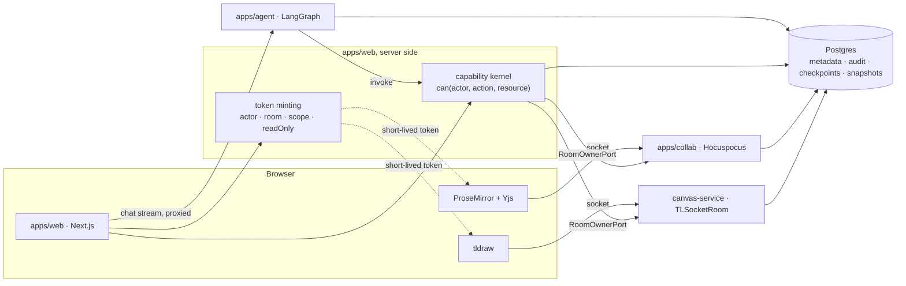
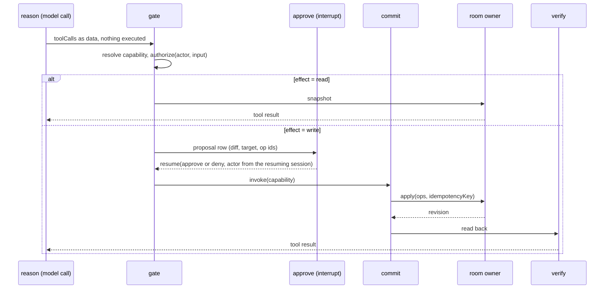

# Platform architecture (v2): content, metadata, one capability layer

**Status:** proposed · **Date:** 2026-11-26 · **Scope:** the whole product, rebuilt as a new major version

Content syncs through a CRDT room owner, metadata lives in Postgres, and every
action — a person's click or an agent's proposal — goes through one capability
layer that checks one authorization function and commits through one port.

## Context

v1 proved four ideas that v2 keeps, and it buried each of them inside a single
Next process:

- **The capability kernel.** One record per semantic operation, one `invoke`,
  `authorize` returning the row it authorized, `callers` deciding exposure, and
  `changes` naming the datasets a successful write touched
  ([capabilities](capabilities.md), [live-updates](live-updates.md)).
- **The actor as a participant.** `UserActor | AgentActor` with `onBehalfOf`, so
  the agent is a member of the room rather than a service account with a bypass.
- **The room-owner split.** PR #53 puts the browser socket, the token
  and the authoritative `TLSocketRoom` in a separate `canvas-service`; the app
  owns access decisions, the service owns the connection and the room.
- **Change keys, not rows.** A capability publishes which datasets changed; a
  browser re-reads through its own authorization.

What v1 got wrong is structural rather than local: one process owns auth, tools,
CRDT-adjacent state, billing and the agent loop; the agent runtime is being
deleted rather than extended; and nothing lets a server-side caller write content
without impersonating a socket.

v2 is a new major version built on a fresh branch, with v1 as reference. That
changes the economics: a wrong abstraction is a rewrite we were already doing,
while a kept abstraction outlives the code that justified it. So the rule for
every decision below is **the design that is correct on its own terms**, not the
one that maps onto today's files.

Two words, to keep the rest readable. **Account** is the active organization
(`organizationId` in the schema); **org id** below means that column. **Room
owner** is the one process allowed to hold a piece of content's CRDT and apply
writes to it.

## 0. Axioms

| #   | Axiom                                                                          | What follows from it                                                                                             |
| --- | ------------------------------------------------------------------------------ | ---------------------------------------------------------------------------------------------------------------- |
| A1  | Content syncs through a CRDT; Postgres stores snapshots, not the live document | The only way to read or write content is the room owner. No SQL UPDATE against a document's body, ever.          |
| A2  | Metadata is relational: comments, tasks, runs, proposals, audit, credits       | These need constraints, joins and transactions, and they must be queryable without loading a document.           |
| A3  | One capability layer, one `can(actor, action, resource)`, for both actors      | A person's action and an agent's proposal differ in _who answers_, not in what runs.                             |
| A4  | The model proposes; the server commits                                         | Model output is data. No tool has an `execute` that writes. Every write is gated, and every write is idempotent. |
| A5  | The browser is never trusted with policy                                       | Tokens carry claims minted server-side; the room owner re-checks at apply time, not just at connect time.        |
| A6  | One owner per fact                                                             | The checkpoint owns the transcript, the ledger owns money, the room owns content. A second copy is a defect.     |

## 1. Topology



Three trust boundaries, and each has exactly one enforcement point:

| Boundary                   | Enforced by                                                 | Never by                           |
| -------------------------- | ----------------------------------------------------------- | ---------------------------------- |
| Browser → room socket      | the room owner's `onAuthenticate`, against a minted token   | a query parameter or a client flag |
| Capability caller → domain | `authorize(ctx, input)` returning the row, `null` = missing | the caller's own pre-check         |
| Model → write              | the graph's `gate` → `approve` → `commit`                   | a tool implementation              |

## 2. Layers

| Layer | Package / process                              | Owns                                                            |
| ----- | ---------------------------------------------- | --------------------------------------------------------------- |
| L0    | pnpm workspaces, `packages/*`, `apps/*`        | module boundaries that the compiler enforces, not a lint rule   |
| L1    | `apps/web` + better-auth                       | identity, accounts, members, roles, invites, token minting      |
| L2    | `packages/capabilities`                        | `can()`, the policy matrix, the actor type                      |
| L3    | `packages/capabilities` + `packages/contracts` | capability definitions, `invoke`, the `RoomOwnerPort` port      |
| L4    | `apps/collab`, `canvas-service`                | the only writers of content; sockets, snapshots, presence       |
| L5    | Postgres                                       | comments, tasks, notifications, runs, proposals, audit, credits |
| L6    | `apps/agent`                                   | the graph, approvals, budgets, the transcript                   |
| L7    | `apps/web`                                     | the interface: chat, editors, presence, approvals               |
| L8/L9 | infra + observability                          | epic; out of scope for this cut, invariants recorded in §11     |

### L0 — Workspaces

pnpm workspaces, strict TypeScript, Vitest, Playwright, ESLint. Six packages to
start — the four the boundaries need, plus the two that would otherwise be copied
into every app:

| Package                 | Contains                                                                     | May import                        |
| ----------------------- | ---------------------------------------------------------------------------- | --------------------------------- |
| `packages/contracts`    | actor, capability types, `RoomOwnerPort`, change keys, realtime event shapes | nothing in the repo               |
| `packages/capabilities` | `define`, `invoke`, `registry`, `can`, presentations                         | `contracts`                       |
| `packages/db`           | Drizzle schema, connection, migrations for every metadata table              | `contracts`                       |
| `packages/config`       | base tsconfig, ESLint config, Vitest preset                                  | nothing in the repo               |
| `apps/web`              | Next.js routes, server actions, adapters, UI                                 | every package                     |
| `apps/agent`            | LangGraph graph, model configuration, tools generated from the registry      | `contracts`, `capabilities`, `db` |

**`apps/collab` is a workspace package that happens to ship as a container.** It
is our code, with its own types, tests and build, so it is treated like the other
apps: typechecked, tested and linted by the same root commands, added by the doc
slice. `canvas-service` is the opposite case and stays the opposite shape: not our
package, vendored infrastructure with config and tests, a container and never a
workspace. The distinction is ownership — a package we maintain gets a build
target; a container we configure does not.

**`packages/db` owns the schema.** Web and the doc service both import it; neither
opens its own connection, writes its own SQL or runs its own migrations. The
agent's checkpoint tables are the deliberate exception: LangGraph's checkpointer
creates and migrates them in its own schema, so `packages/db` never models them and
one owner stays one owner. Everything else is one migration runner, executed as a
job before any long-running process starts. The package holds the schema; the
service that writes rows still owns those facts.

**`packages/config` owns the tool defaults.** One TypeScript base every package
extends, one ESLint config, one Vitest preset. A package that copies the base
instead of extending it fails the skeleton's check, because four copies of a
tsconfig diverge by the second app and nobody notices until the build does.

**The one rule that matters:** `packages/capabilities` imports no framework, no
database client and no `next`. It declares the port; `apps/*` implement it. That
is what keeps `can()` identical for a click and a tool call, and it is the only
boundary a reviewer can't accidentally erode. `packages/db` is the only package
allowed a database client, and `contracts` is the only package allowed no
dependencies at all.

Turborepo is deferred, with a trigger that can be measured rather than argued:
it is adopted when the **warm `pnpm -r build` on CI exceeds 90 seconds on three
consecutive runs**. Until then a root script fans out with `pnpm -r`, which already
orders packages topologically, and `--filter` covers rebuilding only what a
change touched. The trigger is a build-time threshold, not a package count, so
adding the doc service or the database package cannot fire it, and the skeleton's
warm build is a few seconds.

### L1 — Identity and accounts

better-auth with `organization`, `jwt` (JWKS) and `access-control`, in its own
Postgres schema. Every person gets a personal account at sign-up, so every
resource has an org id from its first row.

Two additions beyond v1:

- **The app mints room tokens, not better-auth.** PR #53's shape: a route runs
  the access check, decides `readOnly` from the resource's lifecycle, and signs a
  minute-long token carrying actor, room, org id and permission. The room owner
  verifies it and re-checks membership at apply. Reuse it for docs and for the
  agent's run credential rather than inventing a second scheme.
- **The agent never gets a person's session.** A run gets its own token: `runId`,
  org id, `requestedByUserId`, the granted action set, and a TTL. `can()`
  intersects the requesting person's role with that set, so a run can do _less_
  than its requester, never more.

### L2 — Authorization

`can(actor, action, resource)` is pure, table-driven, tested as a matrix, and
lives with the capabilities. The shape that matters is the one
[capabilities](capabilities.md) already settled: **`authorize(ctx, input)`
loads and returns the row the handler will use**, and `null` reports missing
rather than forbidden.

Three enforcement points, and only three:

1. `invoke` runs `authorize` for every capability call, human or agent.
2. The room owner re-checks the actor's claim against the room at **apply** time,
   because a run outlives a membership and a document outlives a tab. For a
   socket that claim is the minted token; the service-authenticated apply door
   trusts the actor the app already authorized (see
   [doc-room-owner](doc-room-owner.md)), and the run token will be the first
   write that carries its own claim.
3. The socket's `onAuthenticate` for reads.

`can()` is never called by the model, never reachable from the browser, and never
duplicated in a route handler.

### L3 — Capability layer

A capability declares: `name`, `description`, `effect` (`read` | `write`),
`callers` (`human` | `agent` | `both`), Zod `input`/`output`, `authorize`,
`run`, and `changes(output)`. All of it is in `packages/capabilities`, and the
registry is the single source for the action wrappers, the agent's tool schemas
and the thread's presentation of a call.

```ts
export type Effect = "read" | "write";

export type RoomOwnerPort = {
  snapshot(room: RoomRef): Promise<Snapshot>;
  apply(input: {
    room: RoomRef;
    actor: ActorRef;
    /** `(runId, opKey)` for an agent, a request id for a person. Written into
     * the document in the same transaction. */
    idempotencyKey: string;
    ops: ContentOp[];
  }): Promise<{ revision: string; applied: number }>;
  revoke(room: RoomRef): Promise<void>;
};
```

**`effect` decides the approval path, not a "risk" flag.** `read` runs during
reasoning. `write` is collected, gated, optionally approved, then committed. A
capability that writes content and one that writes a database row use the same
path; only the port behind `run` differs.

**Idempotency is declared, not remembered.** A Postgres write relies on a unique
index over `(runId, opKey)`. A content write is harder: Yjs and tldraw ops are
not idempotent, so replaying an insert duplicates it. The key must be recorded
_inside the document_ (an `appliedOps` map on the room, or item ids derived
deterministically from `(runId, opKey, index)`) in the same transaction as the
ops. This is the single most important detail in the layer: without it, one
retried tool call after a timeout writes twice into a document a person is
editing.

### L4 — Realtime content

Two room owners, one contract. That is the accepted cost of two editor engines,
and it is paid once, in `RoomOwnerPort`.

| Surface | Editor             | Room owner                                   | Snapshot            |
| ------- | ------------------ | -------------------------------------------- | ------------------- |
| Canvas  | tldraw             | `canvas-service` (`TLSocketRoom` per canvas) | Postgres, debounced |
| Doc     | ProseMirror/Tiptap | `apps/collab` (Hocuspocus, one room per doc) | `doc.yjsState`      |

`canvas-service` exists in PR #53 and is the reference: token minted by the app,
room opened before upgrade, snapshot persisted on a debounce, archive revokes
live sessions, `readOnly` decided by the room's own answer rather than the
client's. The doc service mirrors it.

Two rules that v1 does not yet have and v2 needs:

- **A server-side apply endpoint.** The agent must not speak Yjs or tldraw. Each
  room owner exposes a service-authenticated `apply` (and `snapshot`) used by the
  capability layer. `canvas-service` needs this added; it has snapshot, forget and
  revoke but no way to apply an op batch. **This is the riskiest item in v2 and
  belongs to the second slice, not the last** — if it cannot be made safe, the
  agent's canvas toolset changes shape.
- **One owner per room, enforced by a lease.** Sticky routing sends a room to one
  instance, and a lease in Postgres says which; a second instance loading the
  same room is a bug that snapshots will hide for a while.

Presence rides the same socket (awareness). Comments do **not** live in the
document: the body, author and thread live in Postgres, and only the anchor — a
`RelativePosition` — lives in the document, because an anchor in SQL drifts the
moment someone edits above it.

### L5 — Metadata

Postgres owns comments, tasks, notifications, run status, proposals, audit and
the credit ledger, with `organizationId` on every table and no RLS as the primary
guard: the server checks `can()` on the way in and every read is scoped by the
actor's account.

**Decision: keep Supabase Realtime for change delivery.** The stack already hosts
Postgres, the token route and the topic policy exist and are covered by two CI
jobs ([live-updates](live-updates.md)), and payloads are change keys — a hint to
re-read, never a row. The alternative, plain Postgres plus `LISTEN/NOTIFY`
relayed over SSE, is only better if Supabase leaves the stack, and it costs a
fan-out relay and a new set of tests. Revisit trigger: self-hosted Postgres
without the Supabase composition.

The `org_id`-and-RLS shape in the brief is the one thing to avoid: two
authorization mechanisms over one dataset will disagree, and the disagreement
will be found by a user rather than a test.

### L6 — Agent service

LangGraph.js in its own process, checkpointer in its own schema. Detail lives in
[agent-architecture](../agent-architecture.md); v2 changes four things there.

- **The ReAct loop is a real `StateGraph`.** `reason` (one model call, tool
  schemas only) and `act` (execution) are nodes; the cycle is a conditional edge;
  `gate`, `approve`, `commit`, `verify` and `reply_budget` sit around it.
- **LangChain is used here, not in the app.** `ChatOpenAI` against the
  self-hosted OpenAI-compatible endpoint, tools and messages as LangChain
  primitives, and `@ai-sdk/langchain` at the edge: the service emits
  `UIMessageChunk` through `toUIMessageStream` and owns the one
  `BaseMessage[] → UIMessage[]` mapper behind its history endpoint. The web app
  stays on the AI SDK and never sees a LangChain type.
- **Every write is gated; only reads are automatic.** "Risky edits" is not a
  policy anyone can test. A write parks at `approve` with a proposal row — diff,
  target, op ids — and the decision resumes with the _resuming_ person's actor, so
  an approval cannot transfer authority.
- **Stop and budget are enforced inside the graph**, between supersteps, against a
  lease flag; credits are reserved in Postgres by the app before the run starts
  and settled after. The service reports usage; it does not own the ledger.

Prompt injection is why the gate is structural: document and canvas content is
untrusted input. Content reaches the model only as a tool _result_, never as
instructions, and no tool result can commit a write on its own.

### L7 — Web app

Next.js, `useChat`, Tiptap, tldraw. Three rules:

- **The chat surface reads history from the agent service**, not from a checkpoint
  and not from a second copy of messages. `/api/agent/*` authenticates, then
  proxies and streams; a disconnect closes the run's lease rather than orphaning
  it.
- **Attribution survives a reload.** Yjs origins are in-memory, so
  `Y.UndoManager` can only revert what this tab did this session. Store the
  attribution in the content: `meta.agentRunId` on tldraw shapes and an
  `agentRun` mark on inserted ProseMirror ranges. Accept strips the mark; reject
  is a normal write through the capability layer, which is why modifications also
  need their inverse op in the journal while the run is open.
- **Approvals are a panel, not a tool.** A parked proposal renders from its
  Postgres row, so a reload shows the same decision.

### L8 — Infra

Epic, out of scope for this cut. Invariants to design for now: every process has
a health endpoint and a readiness that means "can reach Postgres"; the proxy
supports WebSockets and sticky routing by room id; secrets come from the
environment and never from a repo file; migrations run as a job before the app;
backups are restore-tested.

### L9 — Observability and safety

Epic, out of scope for this cut. Invariants: every capability call and every
agent superstep writes a ledger row, so tracing is a query rather than a vendor;
an injection suite runs document content through the graph and asserts that no
write commits without an approval; usage is metered per run and per account, and
the hard stop is tested.

## 3. The write path



A denied write produces a tool result the model can read, an audit row, and no
change to the content. Nothing about the path differs between a canvas shape and
a task assignment except the port.

## 4. What carries over, what is rewritten, what is deleted

v1 is reference material, so this table is the whole migration:

| v1                                                                                                       | v2                                                                                                         |
| -------------------------------------------------------------------------------------------------------- | ---------------------------------------------------------------------------------------------------------- |
| `lib/capabilities` kernel (`define`, `invoke`, `registry`, `presentation`, `changes`)                    | **carried** into `packages/capabilities`; adds `effect`, keeps `callers` and `authorize` returning the row |
| `lib/collab/contracts` (`ActorRef`, `WorkspaceGateway`, realtime events)                                 | **carried** into `packages/contracts`; `WorkspaceGateway` becomes `RoomOwnerPort`                          |
| `canvas-service/*`, `lib/canvas/*` (#53)                                                                 | **carried**, as the reference room owner; gains the internal `apply` endpoint                              |
| [live-updates](live-updates.md) change keys + Supabase Realtime                                          | **carried** unchanged in shape                                                                             |
| `lib/billing` rules and entitlements, `lib/identity`, `lib/organizations`, `lib/media`                   | **carried**; ports and pure rules survive, adapters re-point at the new app                                |
| `lib/ai/runtime` (`ToolLoopAgent`), `lib/ai/thread/*` (except composer and read-aloud), `lib/ai/tools/*` | **deleted**; replaced by `apps/agent`                                                                      |
| `agentPrompt`, `agentConversation`, `agentMessage` tables                                                | **deleted**; checkpoints own the transcript, new `run`/`proposal`/`usage` rows own identity and money      |
| `lib/ai/providers`                                                                                       | **deleted** as a module; model configuration moves into `apps/agent`                                       |
| one Next app with `lib/*` folders                                                                        | **replaced** by workspaces; the kernel outlives the app that hosted it                                     |

No shims, no dual writes, no "match the old behaviour". If a v1 module is not in
the first column of this table, it is reference, not a port.

## 5. Rebuild order

Risky-first, not layer-first. Tenancy is well-understood work; server-side content
writes and idempotency are not, and they decide the shape of the agent's tools.

| #   | Slice                                                                                   | Proves                                                     |
| --- | --------------------------------------------------------------------------------------- | ---------------------------------------------------------- |
| 1   | Branch, workspaces, `contracts`, `db`, `config`, compose, CI                            | the boundaries compile and the port has a fake             |
| 2   | One workspace, one doc: Hocuspocus, `can()`, three doc capabilities, both actors tested | a person and the agent write the same doc through one path |
| 3   | `canvas-service` from #53 plus a service-authenticated `apply`                          | an agent can edit a canvas without a socket (the spike)    |
| 4   | `apps/agent`: graph, `reason`/`act`, one read + one write with approval, restart resume | durability, the gate, and the transcript as the only copy  |
| 5   | `apps/web`: chat panel, both editors, proposal UI, attribution                          | the loop a person actually uses                            |
| 6   | Accounts, invites, roles, run tokens                                                    | tenancy over a working product, not before it              |
| 7   | Comments (anchors), tasks, notifications, audit                                         | metadata without a second copy of content                  |
| 8   | Dashboard conversion agent, board, billing and credits                                  | parity with v1                                             |

Metering at slice 4 is a stub: the graph enforces a step budget, and the ledger is
added at slice 8, because a hard stop needs the account model from slice 6.

**v2 gets its own database.** Its own migrations, its own checkpointer schema,
v1 left runnable on `main` for lookup. Sharing a schema between a version being
deleted and a version being built is how a rebuild acquires a compatibility
layer nobody asked for.

## 6. Deferred

- Per-document sharing, share links, and any agent history in a share link.
- MCP exposure of the capability registry.
- Presence polish beyond awareness, and agent cursors that follow the run.
- A queryable action log beyond what the ledger already records.
- Multi-region, horizontal scaling of the room owners, and the L8/L9 epics.
